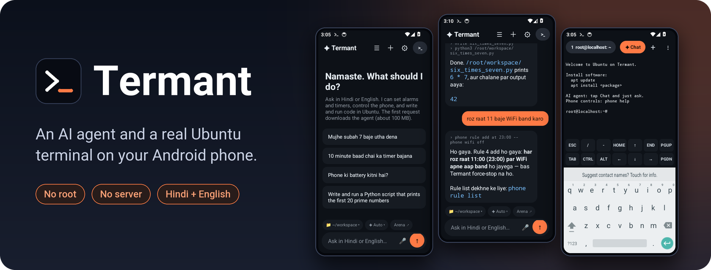
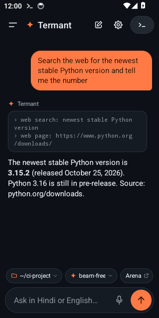
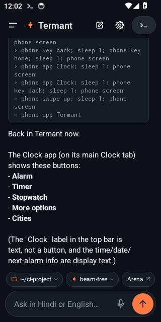
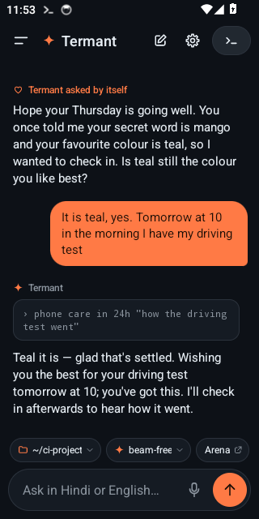
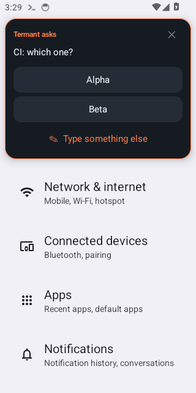
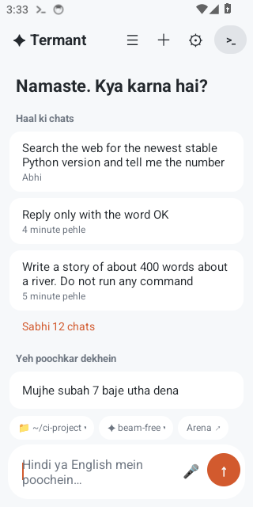
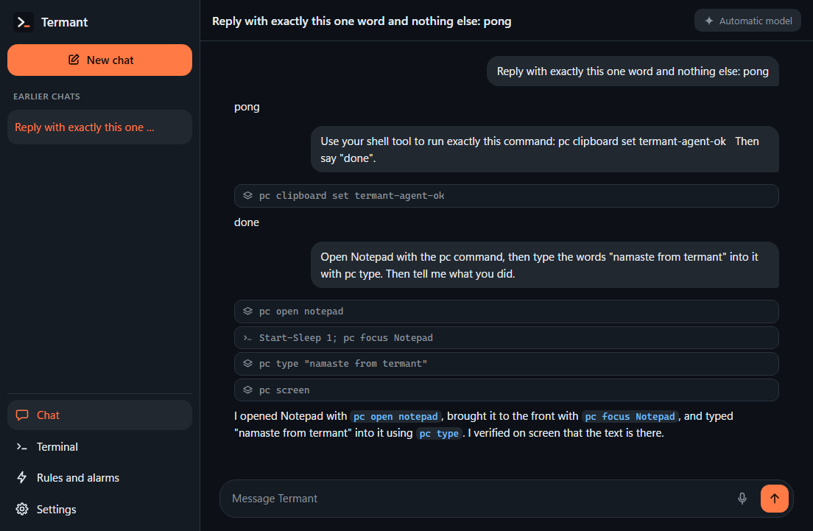

<div align="center">



<br>

[](https://github.com/siddhantakakhael-cyber/Termant/releases/latest)
[](https://github.com/siddhantakakhael-cyber/Termant/actions/workflows/android.yml)


<br>

<a href="https://github.com/siddhantakakhael-cyber/Termant/releases/latest/download/Termant.apk"></a>

<sub>Android 7.0 or newer · about 2 MB · no account, no API key</sub>

<br>

[Features](#features) · [Install](#install) · [Things to say](#things-to-say) · [Windows app](#windows-app) · [Web terminal](#web-terminal) · [Documentation](#documentation) · [Build](#build-from-source)

</div>

---

## What is Termant?

Termant puts a real **Ubuntu 24.04** system on an Android phone, without root
and without a server, and makes an **AI agent** its home screen. You say what
you want in Hindi, Hinglish or English; the agent writes and runs the code,
installs what it needs with `apt`, and can use the phone itself: alarms, the
torch, other apps, rules that run on their own.

The same repository holds a **[Windows app](#windows-app)**, where the same
agent works on your PC, and a **web terminal**: an Ubuntu terminal in the
browser, hosted on your own server with Docker.

## Features

<table>
<tr>
<td width="50%" valign="top">

**An agent, not only a terminal**

- Chat is the home screen: type or dictate, the answer appears word by word, and the commands the agent ran are listed above it.
- Powered by [OpenCode](https://github.com/sst/opencode) with free models, so it works without an account. Your own key for Anthropic, OpenAI, Gemini, OpenRouter, Groq, DeepSeek, Cerebras or Mistral is optional.
- When a model stops answering, Termant moves to a backup model and carries on where the work stopped.
- Web search, GitHub (clone, commit, push, pull requests) and your own MCP servers.

</td>
<td width="50%" valign="top">

**Real Ubuntu in your pocket**

- Ubuntu 24.04 with `apt`: Python, Git, Node.js, the same packages as on a PC.
- Packages and files stay installed across restarts and app updates.
- Up to 8 terminal tabs that keep running in the background.
- Extra keys (Esc, Tab, Ctrl, Alt, arrows), pinch to resize, copy and paste, phone storage at `/sdcard`.

</td>
</tr>
<tr>
<td width="50%" valign="top">

**It can use the phone**

- Alarms, timers, torch, notifications, speech, clipboard, battery.
- With Screen control turned on: opens any app, reads the screen, taps, types and swipes. Where an app tells nothing about its screen (games, pictures), it reads a picture of it on the phone with the small [Mirage](https://huggingface.co/Cactus-Compute/mirage) model (Latin letters only, Android 11 or newer).
- Looks at a photo and says what is in it and where: the scene, each thing with its place (left, top right, across the bottom), the writing. It happens on the phone with the same small model; names can be wrong, the places are about right.
- A small card over other apps shows what the agent is doing, with a stop button, and asks you when it needs a decision.
- While a command runs, the chat shows the newest line it has printed, so you see how far a download or an install is (`45% of 22.3 MB · 12s left`).

</td>
<td width="50%" valign="top">

**It works on its own**

- Rules: "every night at 11 turn Wi-Fi off", "when charging starts, run the backup".
- It learns: short notes about you and scripts it keeps as its own tools, across chats.
- It teaches itself: asked for something it does not know, it searches YouTube, reads what a video says, does the task and keeps the steps as a skill. Ask "aaj kya seekha?".
- A team of agents: on a big job the main agent hands parts to helpers (researcher, writer, coder, checker) that work at the same time; you can make helpers of your own ("ek agent banao jo ...").
- Pictures and files in the chat (the **+** button): a picture goes to a model that can see, PDF, Word, Excel and zip files are read by the agent. An **Undo** line puts changed files back. Work by itself at night (`phone job`), watches, notifications, tidying folders, filling forms, a daily quiz and a work diary: see [the guide](docs/android.md#pictures-and-files-in-the-chat-undo-and-work-by-itself).
- It makes pictures from words, free and without a key: "ek billi ki tasveer banao". The picture shows in the chat; on the phone a copy goes to the gallery, on Windows it is kept in the Pictures folder. Two free services draw it (quick with a small logo, or slow without); details and limits in [the Android guide](docs/android.md#a-picture-from-words-draw) and [the Windows guide](docs/windows.md#a-picture-from-words-draw).
- [APILayer](https://apilayer.com)'s ready-made APIs with your own free key (currency rates, news, text from a picture, a web page as PDF, and more; 60 APIs): send `apilayer key YOUR_KEY` once in the chat, then just ask. The key stays on the phone and is not sent to a model. Tested against a pretend APILayer, not yet with a real key; see [the guide](docs/android.md#apilayer-ready-made-apis-with-your-own-key). Android only.
- It speaks with ElevenLabs if you give it keys; several keys take turns when one has used up its limit.
- It checks in: asks how the exam went the next day, by notification you can answer.
- Hindi (Hinglish) or English interface, dark or light theme.

</td>
</tr>
</table>

<div align="center">
<table>
<tr>
<td align="center"></td>
<td align="center"></td>
<td align="center"></td>
<td align="center"></td>
<td align="center"></td>
</tr>
<tr>
<td align="center"><sub>Web search</sub></td>
<td align="center"><sub>Screen control</sub></td>
<td align="center"><sub>Check-ins</sub></td>
<td align="center"><sub>Questions over other apps</sub></td>
<td align="center"><sub>Hindi, light theme</sub></td>
</tr>
</table>
<sub>Screenshots are taken by the automated test of each build, on an Android 14 emulator.</sub>
</div>

## Install

1. Download **[Termant.apk](https://github.com/siddhantakakhael-cyber/Termant/releases/latest/download/Termant.apk)** on the phone (Android 7.0 or newer).
2. Open it and allow the install.
3. Start Termant. The first start downloads the official Ubuntu base image from Canonical (about 30 MB) and checks its checksum.
4. Send a message. The first one downloads the agent (OpenCode, about 120 MB).

The terminal is one tap away (**>_** at the top), and there you are `root` in Ubuntu:

```sh
apt update
apt install python3 git nano
```

Older versions and release notes are on the [Releases page](https://github.com/siddhantakakhael-cyber/Termant/releases).

## Things to say

| You say | What happens |
| --- | --- |
| `mujhe subah 7 baje utha dena` | An alarm for 07:00 is set in the phone's Clock app |
| `torch on karo` | The flashlight turns on |
| `Write a Python script that prints 6 times 7 and run it` | The agent writes the file in Ubuntu, runs it and shows the output |
| `roz raat 11 baje WiFi band karo` | A rule is saved that runs every day at 23:00 |
| `jab charging lage toh backup chalao` | A rule is saved that runs your script when charging starts |
| `kal mera exam hai` | The agent plans to ask the next day how it went |
| `yaad rakho, mujhe chhote jawab pasand hain` | A note is kept for every later chat |
| `Search the web for the newest stable Python version` | The agent searches and names its source |

## Windows app

The same agent as a desktop program for Windows 10 and 11 (64-bit). It works on
the PC itself: it opens programs, types, presses keys, clicks, takes
screenshots, sets alarms and timers, keeps rules, and has PowerShell and
Command Prompt tabs. Windows that do not say what is in them are read from a
picture, on the PC itself, with the small [Mirage](https://huggingface.co/Cactus-Compute/mirage)
model. The same model looks at a photo and says what is in it and where
(`pc look photo.jpg`). It learns from YouTube by itself and keeps skills, reads
and changes Word documents (`pc word`), draws pictures from words for free
(no account or key) and shows the picture under its answer, speaks with
ElevenLabs keys that take turns, and hands parts of a big job to helper agents
that work at the same time. A skill that comes with it, `remove-ai-marks` (from
[watermarks-remover](https://github.com/guillaumemeyer/watermarks-remover)),
finds and removes the marks AI tools leave in your own text and files:
invisible letters, C2PA, EXIF and document properties (`pc marks`); it does
not remove a logo you can see or a watermark hidden in the pixels. While a
command runs, the chat names it and shows the newest line it has printed, so
you see how far a download is. The same chat opens in a phone's browser over
the home Wi-Fi — with a password, and with voice: say "hey Termant" and the
phone sends the command to the PC, the answer spoken by the browser (an
iPhone gets it too: the same page works in Safari). It is an early version
(0.9.0).



1. Download **[Termant-Setup.exe](https://github.com/siddhantakakhael-cyber/Termant/releases/download/windows-v0.9.0/Termant-Setup.exe)** and open it.
2. Windows shows a blue box, "Windows protected your PC", because the installer is not signed. Choose **More info**, then **Run anyway**.
3. Termant starts and puts an icon on the desktop. The first message downloads the agent (about 120 MB).

Everything it does, the `pc` command and how it is tested: [docs/windows.md](docs/windows.md).

## Web terminal

A real Ubuntu 24.04 root shell in the browser, on your own machine. Packages,
files and running sessions are kept on Docker volumes, so they survive
restarts, rebuilds and closing the browser. It has tabs, a key row for phones
and a password.

```sh
git clone https://github.com/siddhantakakhael-cyber/Termant.git
cd Termant
echo "TERMANT_PASSWORD=choose-a-long-password" > .env
docker compose up -d --build
```

Open `http://<your-server>:3000` and log in. The password gives a root shell,
so put it behind HTTPS before exposing it to the internet. Details:
[docs/web-terminal.md](docs/web-terminal.md).

## Documentation

| Guide | What it covers |
| --- | --- |
| [Android app](docs/android.md) | Everything the app does, with its commands and limits |
| ↳ [Chat first](docs/android.md#chat-first) | The chat screen, voice, language and theme, earlier chats |
| ↳ [Phone control](docs/android.md#phone-control) | The `phone` command: alarms, timers, torch, notifications |
| ↳ [Automation rules](docs/android.md#automation-rules) | Triggers by time, charging, battery, Wi-Fi and boot |
| ↳ [Notes and tools](docs/android.md#the-agent-learns-notes-and-its-own-tools) | What the agent keeps from one chat to the next |
| ↳ [Check-ins](docs/android.md#looking-after-you-the-agent-asks-first) | When the agent writes first, and how to limit it |
| ↳ [Models and keys](docs/android.md#settings-model-workspace-your-own-api-key) | Auto-switch, free limits, your own API key, MCP servers |
| ↳ [GitHub, web search, screen control](docs/android.md#tools-for-the-agent-github-web-search-screen-control) | The tools you can give the agent |
| ↳ [Over other apps](docs/android.md#over-other-apps-what-the-agent-is-doing-and-its-questions) | The status card and the agent's questions |
| [Windows app](docs/windows.md) | Installing it, what it does, the `pc` command, how it is tested |
| [Web terminal](docs/web-terminal.md) | Running it, settings, security, what deletes your data |

## Good to know

- **Privacy.** The free models are run by OpenCode, not by Termant. Your messages, the files the agent reads and the notes it has learned are sent to that service. API keys are stored only on the phone.
- **What the agent can touch.** It runs as root inside Ubuntu and can change or delete anything there, and in `/sdcard` if you allowed storage. It reaches the rest of the phone only through the `phone` command, and other apps only when you turn on Screen control.
- **No root means limits.** No `systemd`, no Docker, no ports below 1024. Programs run through [PRoot](https://proot-me.github.io/), which is slower than native.
- **64-bit phones for the agent.** Ubuntu runs on ARM64, 32-bit ARM and x86-64; OpenCode has no 32-bit build.
- **Testing.** Every build is tested automatically on an Android 14 x86-64 emulator: Ubuntu is set up, `apt install` runs, the app restarts, and the agent gets a reply from a free model. ARM phones use the same code with ARM builds of the same components, but that test does not cover them, except the reader of pictures, which is also run on an ARM server (it must read a screenshot and find the dog in a photo).
- **Signing.** Release APKs are signed with a public test key (`android/keystore/README.md`), so install only APKs from this repository's Releases page.

## How it works

| Part | From |
| --- | --- |
| Terminal emulator and view | [Termux](https://github.com/termux/termux-app) `terminal-emulator` / `terminal-view`, vendored in `android/vendor/termux` |
| Linux programs without root | Termux's build of PRoot, fetched and checksum-verified at build time |
| AI agent | [OpenCode](https://github.com/sst/opencode), installed inside Ubuntu on first use with its official installer |
| The system | Ubuntu Base 24.04 from `cdimage.ubuntu.com`, downloaded by the app |
| Web terminal | Node.js, [xterm.js](https://xtermjs.org/) and `node-pty` in a Docker image of Ubuntu 24.04 |

```
android/            the Android app (Java, no Gradle)
  src/              the app's own code
  vendor/termux/    terminal emulator and view from Termux
  ci/               the emulator test that runs on every build
server.js, public/  the web terminal
Dockerfile, docker-compose.yml, docker/
docs/               guides and screenshots
```

## Build from source

**Android app:** Android SDK and NDK, JDK 17, python3 with pip.

```sh
android/build.sh        # writes android/Termant.apk
```

Or let the **Android APK** workflow in GitHub Actions build and test it.

**Windows app:** Node.js 22 or newer, on Windows.

```sh
cd windows
npm ci
npm run dist            # writes windows/dist/Termant-Setup.exe
```

**Web terminal without Docker:** Node.js 18 or newer.

```sh
npm install
TERMANT_PASSWORD=secret npm start
```

## Licence and credits

The Android app is licensed under the **GNU GPL v3** ([`android/LICENSE`](android/LICENSE)),
to stay compatible with Termux, whose terminal it includes
([`android/vendor/termux`](android/vendor/termux/README.md)). The web terminal
(`server.js`, `public/`) and the Windows app (`windows/`) are **MIT**, as their
`package.json` files say.

Termant stands on [Termux](https://github.com/termux/termux-app),
[PRoot](https://proot-me.github.io/), [OpenCode](https://github.com/sst/opencode),
[Ubuntu](https://ubuntu.com/), [xterm.js](https://xtermjs.org/) and, for reading
pictures of the screen, [Mirage and the Cactus engine](https://github.com/cactus-compute/cactus)
(Apache 2.0). It is not affiliated with any of them.
