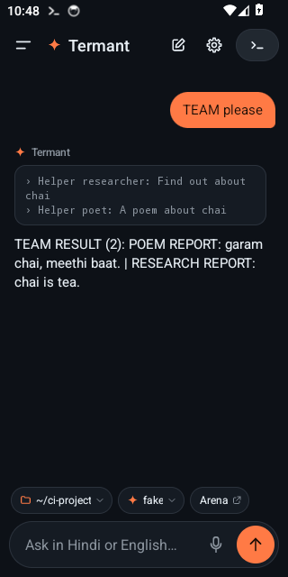
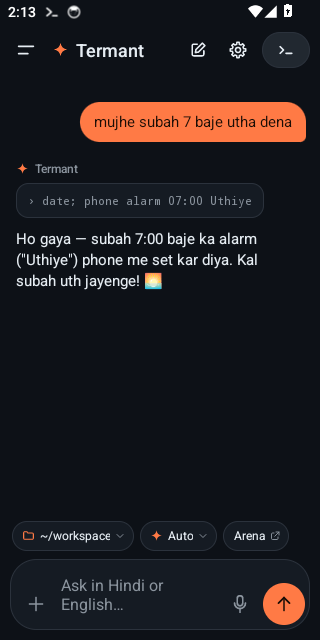
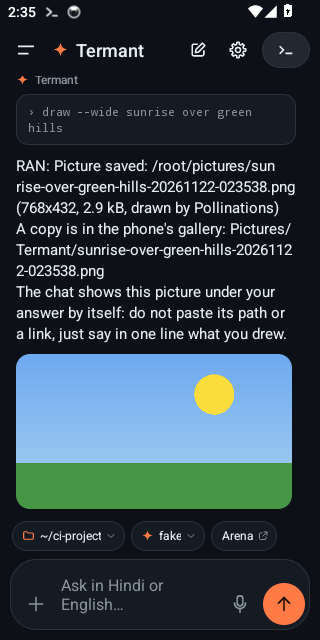

# Termant for Android: the guide

[← Back to the front page](../README.md)

A real Ubuntu 24.04 system on your phone with an AI agent as its home screen. No root, no server.

## Contents

- [Install](#install)
  - [AI agent](#ai-agent)
  - [Limits](#limits)
  - [How it works](#how-it-works)
- [Chat first](#chat-first)
- [Listen for "hey Termant"](#listen-for-hey-termant)
- [Phone control](#phone-control)
- [Photos: what is in a picture, and where](#photos-what-is-in-a-picture-and-where)
- [Automation rules](#automation-rules)
- [The agent learns: notes and its own tools](#the-agent-learns-notes-and-its-own-tools)
- [Learning by itself: YouTube, skills, "aaj kya seekha?"](#learning-by-itself-youtube-skills-aaj-kya-seekha)
- [A team of helper agents](#a-team-of-helper-agents)
- [Pictures and files in the chat, Undo, and work by itself](#pictures-and-files-in-the-chat-undo-and-work-by-itself)
- [A picture from words: draw](#a-picture-from-words-draw)
- [A video from a video: the timeline and clip](#a-video-from-a-video-the-timeline-and-clip)
- [APILayer: ready-made APIs with your own key](#apilayer-ready-made-apis-with-your-own-key)
- [How far a download is: the newest line of a running command](#how-far-a-download-is-the-newest-line-of-a-running-command)
- [Voices: the free Gemini voice and ElevenLabs keys](#voices-the-free-gemini-voice-and-elevenlabs-keys)
- [Faster answers](#faster-answers)
- [Looking after you: the agent asks first](#looking-after-you-the-agent-asks-first)
- [Settings: model, workspace, your own API key](#settings-model-workspace-your-own-api-key)
- [Tools for the agent: GitHub, web search, screen control](#tools-for-the-agent-github-web-search-screen-control)
- [Over other apps: what the agent is doing, and its questions](#over-other-apps-what-the-agent-is-doing-and-its-questions)

## Install

**Download:** [Termant.apk](https://github.com/siddhantakakhael-cyber/Termant/releases/latest/download/Termant.apk) (Android 7.0 or newer, about 2 MB)

Open the APK on your phone and allow the install. The first start downloads
the official Ubuntu base image from Canonical (about 30 MB) and checks its
checksum. After that you are `root` in Ubuntu:

```sh
apt update
apt install python3 git nano
```

- **AI agent chat is the home screen.** It uses [OpenCode](https://github.com/sst/opencode), an open-source agent that writes, edits and runs code for you. It comes with free models, so it works without an account or API key. First use downloads it (about 120 MB).
- **Real Ubuntu with apt.** The same packages as on a PC, for ARM64, 32-bit ARM and x86-64 phones.
- **Everything stays installed.** Ubuntu lives in the app's storage. Packages and files survive closing the app, reboots and app updates. Only uninstalling the app, clearing its data, or "Reinstall Ubuntu" removes them.
- **Sessions keep running** in the background (see the notification), up to 8 tabs.
- **Extra keys:** ESC, TAB, CTRL, ALT, arrows, HOME, END, PGUP, PGDN.
- **Pinch** to resize text, **long-press** to select, copy and paste.
- **Phone storage** appears at `/sdcard` after you allow it from the menu.

### AI agent

The chat screen talks to the agent for you. For the full OpenCode interface, open the terminal and choose **AI agent (OpenCode)** in the menu (or run `termant-agent` in any tab). The agent works in `~/workspace`;
`cd` to another folder first to use it there. Inside OpenCode, `/models` switches model and
`/connect` adds your own provider key if you want a paid model.

- The free models are run by OpenCode, not by Termant. Your prompts and the files the agent reads are sent to their service, and the list of free models changes over time.
- The agent runs as root inside Ubuntu and can change or delete anything there, and in `/sdcard` if you allowed storage. It cannot touch the rest of the phone.
- OpenCode has no 32-bit build, so the agent needs a 64-bit phone.

### Limits

- No root means no `systemd`, no `mount`, no Docker, and ports below 1024 cannot be opened. Start services directly (for example `nginx` on port 8080, `sshd -p 8022`).
- Programs run through [PRoot](https://proot-me.github.io/), which is slower than native, mostly for work with many small files.
- Android 12 and newer may stop background programs that use many processes ("signal 9"). This is an Android limit that also affects Termux.
- Every build is tested automatically on an Android 14 x86-64 emulator (set up Ubuntu, `apt install`, restart, package still there, install OpenCode and get a reply from a free model). ARM phones use the same code with ARM builds of the same components, but are not covered by that automatic test. One part is: the reader of pictures is also run on an ARM server, where it must read a real screenshot of the phone and find the dog in a photo.

### How it works

| Part | From |
| --- | --- |
| Terminal emulator and view | [Termux](https://github.com/termux/termux-app) `terminal-emulator` / `terminal-view`, vendored in `android/vendor/termux` |
| Running Linux programs without root | Termux's build of PRoot, fetched and checksum-verified at build time |
| AI agent | [OpenCode](https://github.com/sst/opencode), installed inside Ubuntu on first use with its official installer |
| The system | Ubuntu Base 24.04 from `cdimage.ubuntu.com`, downloaded by the app |
| Reading a picture of the screen, looking at a photo | [Mirage](https://huggingface.co/Cactus-Compute/mirage) on the [Cactus](https://github.com/cactus-compute/cactus) engine (Apache 2.0): the engine is fetched and checksum-verified at build time and linked into a small program (`android/mirage/reader.c`); the model is downloaded by the app |

Build it yourself with `android/build.sh` (Android SDK + NDK, JDK 17, python3 with pip; no Gradle), or let the
**Android APK** GitHub workflow do it. The app is licensed GPLv3 (`android/LICENSE`).
Release APKs are signed with a public test key (`android/keystore/README.md`), so only
install APKs from this repository's Releases page.

## Chat first

Termant opens as a chat, not a terminal. Type or speak what you want in Hindi,
Hinglish or English; the agent answers in a chat bubble and lists the commands
it ran above its answer. **New chat** starts a fresh conversation.

The answer appears while it is being written, word by word, instead of all at
once at the end. The microphone button next to the message box takes
dictation inside the app when the phone has a speech service (Google's, on
most phones); what you say lands in the message box so you can correct it
before sending.

**What it is doing:** while the agent works, the bubble names the current
step and what it is about: *Thinking* (with the sentence being thought, when
the model shows it), *Running a command* with the command, *Reading a file*
with its path, *Searching the web* with the search words, *Working on the
screen*, *Working with Git / GitHub*, *Installing*, *Writing the answer*, and
so on, with the time waited. While there is nothing to add it shows a tip.

**Language and look:** the app's own buttons and messages are in Hindi
(Hinglish) by default. Settings → *Bhasha (Language)* switches to English and
back, and *Theme* switches between dark and light, the terminal included. Both
apply at once.

Earlier chats are kept: they are listed on the new-chat screen and under the
menu button at the top left (a panel slides in from the edge), and opening one continues it where it stopped (it carries on in
the same OpenCode session, so the agent still knows what was said).

The real Ubuntu terminal is one tap away: **>_** at the top. **Chat**
(or Back) in the terminal returns to the chat. The first chat message downloads
the agent (OpenCode, about 120 MB).

## Listen for "hey Termant"

New in 0.26.0. **Settings → Listen for "hey Termant"**: while it is on, the
phone waits for the words, and when you say **"hey Termant"** it waits for the
task; say it and the task in the same breath works too. The task goes into the
chat like a typed message, and the answer is there as usual. A notification
says when it is waiting, and it appears for a moment when it has heard the
words.

- The microphone must be allowed once: tap the microphone button in the chat
  once, and the permission stays for the wake word too.
- The words are heard by the phone's own speech service, the same one the
  microphone button uses (Google's, on most phones). A phone without a speech
  service says so in the notification and turns the setting off again.
- When you are dictating into the message box, the wake word is quiet, so it
  does not hear your own words.
- Whether the service keeps working with the screen locked is up to the phone
  and its battery settings. The test machine has no microphone and no speech
  service, so none of this is run in the tests: the tests can only see that
  the app builds with the setting and that it starts off. What really happens
  when you say the words has to be checked on a real phone.

On an iPhone there is no Termant app; the same "hey Termant" voice works on
the **web chat page** of the Windows app, opened in Safari on the same Wi-Fi
(see [the Windows app](windows.md#chat-from-the-phone-the-web-chat)).

## Phone control

The agent can use the phone, not only write code. In the chat, type (or
tap the microphone and say) what you want in Hindi, Hinglish or English:

| You say | What happens |
| --- | --- |
| `mujhe subah 7 baje utha dena` | an alarm for 07:00 is set in the phone's Clock app |
| `3 minute baad chai ka timer bajana` | Termant rings after 3 minutes |
| `torch on karo` | the flashlight turns on |

It does this with the `phone` command, which also works by hand in any tab:

```
phone alarm 07:00 Wake up     phone timer 10m Tea      phone ring / phone stop
phone notify "Title" "Text"   phone say "hello"        phone torch on|off
phone battery                 phone vibrate 500        phone clipboard get|set
phone open https://…          phone wake on|off        phone help
```

If the Clock app cannot be used (for example Termant is not on screen),
Termant sets its own alarm and rings itself. If `phone alarm` fails
altogether, the agent is told to write a small Python script that waits until
the time and rings, and to run it; that only works while Termant stays running.

Limits: an alarm kept by Termant itself is lost if the phone restarts or the
app is force-stopped; alarms in the Clock app are not. The request is sent to
OpenCode's free model service, so it needs internet.

## Photos: what is in a picture, and where

Ask in the chat `is photo me kya kya hai, aur kaha?` after taking a photo, or
name a file. The agent runs one of these, and you can too, in any tab:

```
phone look /sdcard/DCIM/Camera/IMG_1234.jpg    a picture file (JPEG, PNG, WebP, GIF, BMP)
phone look last                                the newest picture on the phone
phone look                                     what the screen shows now, as a picture
```

The picture is looked at on the phone by
[Mirage](https://huggingface.co/Cactus-Compute/mirage), the same small model
that [reads the screen](#tools-for-the-agent-github-web-search-screen-control);
it is not sent anywhere. For a photo of a dog sitting in front of a bicycle,
with a pickup truck in the street behind, it gives:

```
Picture dog.jpg (768x576), seen by Mirage in 7.0 s.
Mirage is a small model on this phone: the places are about right, but a name can be wrong ...
In short: black and tan dog, red bicycle, white pickup, yellow bench, trees
Scene: setting = park; surface = wooden deck; lighting = daylight; time of day = day
Things (6), highest score first. Each line: name, score, where its middle is, how much of the picture it covers, how it looks, and its middle point (in the picture's own pixels):
- dog, 59%: left, 14% of the picture; foreground; black and tan, standing @221,366
- bench, 42%: across the middle, 40% of the picture; background; yellow, wood @384,317
- tree, 40%: across the top, 35% of the picture; background; green @385,103
- tree, 36%: across the top, 21% of the picture; background; green @385,63
- trash can, 35%: top left, 4% of the picture; black @42,115
- bicycle, 33%: middle, 21% of the picture; red, leaning @353,293
Also there, place not marked: pickup (background right; white, parked)
Maybe (this part is often wrong): dog standing on bench; bicycle leaning against bench; pickup behind bicycle
```

How to read it, and what it cannot do:

- **The place of a thing is worked out from the box Mirage draws around it**,
  and those boxes were about right on the photos tried: *left*, *top right*,
  *across the bottom*, *down the middle*, *all over*. Many things of one kind
  (the windows of a house) come as one line that says how many are where.
  `@x,y` is the middle of the thing; after `phone look` without a file it is a
  point on the screen that `phone tap X Y` can tap.
- **A name can be wrong, even with a high score.** On the photos tried it
  called a cut orange "avocado half" with 87%, and here the porch wall is a
  "bench" and the porch a "park". So the agent is told to say "it looks like", and to
  look at the file itself too when its model can see images.
- **"Maybe" is wrong often**: it said people stood *on* a bus they stood in
  front of.
- It does not know who a person is. It reads Latin letters only, and writing
  in a photo (a sign, a bus) mostly comes out garbled.
- `phone look last` and files under `/sdcard` need the phone storage
  permission (menu → *Allow phone storage*). `phone look` without a file needs
  Screen control and Android 11 or newer. A file can be 32 MB at most.
- The first use downloads the model (22 MB) once. On a phone with a 32-bit
  system it probably does not run.
- Tested on the emulator of every build with the photo above: from a file in
  Ubuntu, as the newest picture in the phone's gallery, and the Settings app
  as a picture of the screen; the dog must be found, on the left. There it
  took 7 seconds a picture (an x86 machine, where the engine is slow); the
  same program on an ARM server took under half a second. It has not been
  tried on a real phone, and only on 14 photos in all.

## Automation rules

Ask once, and the app keeps doing it by itself:

| You say | Rule the agent creates |
| --- | --- |
| `roz raat 11 baje WiFi band karo` | `phone rule add at 23:00 -- phone wifi off` |
| `jab charging lage toh backup chalao` | `phone rule add charging -- bash /root/backup.sh` |
| `WiFi se judte hi mummy ko message bhejo` | `phone rule add wifi-connected -- phone sms +91… "…"` |

Triggers: `at HH:MM` (every day), `every 30m` (again and again, 15 minutes to
24 hours), `charging`, `unplugged`, `battery-below N`, `wifi-connected`,
`wifi-lost`, `boot`. The action is any command in Ubuntu.
Rules are listed in **Settings** (switch off or delete there) and with
`phone rule list`. A rule that fails shows a notification.

Limits: there is no trigger for a place, a weekday or a date; "when I reach
home" can only be approximated by `wifi-connected`, which fires on any Wi-Fi.
Rules stop if Termant is force-stopped or closed with **Exit**; after a phone
restart they come back by themselves. Some phones kill background apps
aggressively: exclude Termant from battery optimisation there. Sending SMS
needs the SMS permission, which Android asks for the first time.

## The agent learns: notes and its own tools

The agent keeps two things from one chat to the next, both inside Ubuntu on
the phone:

- **Notes**: short sentences about you and about what works on this phone
  ("The user wants short answers in Hinglish", "The Clock app cannot be read
  through Screen control; use `phone alarm`"). It saves one when you tell it
  something lasting ("yaad rakho ...", "hamesha ..."), when you correct it, or
  when it finds out how something works here.
- **Its own tools**: when a job of several steps comes up again, or you say
  "iska tool bana lo", it writes a script, tests it and keeps it as a command
  (in `/usr/local/bin`), which also works in the terminal and in rules.

Both are written into one file (`~/.config/termant/learned.md`) that OpenCode
reads at the start of every chat, so a new chat knows them. The agent does
this with the `learn` command, and you can use it in the terminal too:

```
learn note "One short sentence."        learn notes        learn forget N
learn tool NAME "what it does" FILE     learn tools        learn drop NAME
```

**Settings → What the agent has learned** (at the bottom) lists the notes and
tools, removes one with ✕, and turns learning off; then nothing is saved and
the agent is not given what it had learned (tools stay usable as commands).

Limits: at most 40 notes of 240 letters and 30 tools. A note that contains one
of your saved keys is refused, and the agent is told never to save passwords,
PINs or OTPs, but nothing can check every sentence: look at the list now and
then. Notes stay on the phone, yet they are sent to the model's service with
each message, like the message itself. Whether something gets saved is the
model's decision; weaker free models may need to be told ("yaad rakho"). This
does not change the app itself: the app only changes with a new version.

## Learning by itself: YouTube, skills, "aaj kya seekha?"

When you ask for something the agent does not know how to do, its rules tell it
not to answer "nahi kar sakta" but to learn first:

1. It looks at the skills it already has (`learn skills`).
2. It searches YouTube (`learn youtube search "scan a document with the phone"`)
   and reads what is said in a video (`learn youtube read ID`; `--lang hi` for
   Hindi captions, `--from 10` to go on from minute 10). Web search is its
   other source.
3. It does the task, and when it worked it writes the steps down as a skill:
   `learn skill NAME "what it is for" steps.md LINK`.
4. It ends the answer with what it learned ("Aaj maine yeh seekha: ...").

Ask "aaj kya seekha?" and it runs `learn today` (or `learn today 7` for the
last week), which lists the skills, notes and tools of that day. The names of
all skills are given to the agent at the start of every chat; it reads one
(`learn show NAME`) when a task fits. `learn unlearn NAME` removes one.

- "Reading a video" means reading its captions. A video without captions gives
  only its description, and the agent is told to take another one.
- YouTube has no official way to do this without an account. Termant asks the
  same addresses the YouTube website and app ask; YouTube can change or refuse
  them, and then the agent falls back to web search.
- Whether the agent really learns before answering, and how good the skill is,
  depends on the model. Weak free models may need to be told "YouTube se seekh
  kar karo". At most 60 skills of 6,000 letters. Skills are not yet listed in
  Settings; use `learn skills` or ask the agent.
- Tested in the emulator against a pretend YouTube inside Ubuntu (53 checks:
  search, captions in both forms, language, cut and continue, skills, today).
  The real YouTube was tried from the emulator too: the search answered with
  8 videos, but reading a video was refused ("Sign in to confirm you're not a
  bot"), as YouTube does for data centres. Whether reading works on a phone's
  own connection has not been tried. That a model really goes and learns when
  it does not know something was not tested either.

## A team of helper agents

On a big job the agent does not do everything one step after the other any
more. It is the main agent and hands parts of the job to helper agents. Each
helper works in its own conversation, several at the same time, and reports
back; the main agent puts the results together and answers you.

| Helper | What it is for |
| --- | --- |
| `researcher` | Finds things out on the web and YouTube; reports facts and steps with their links |
| `writer` | Writes or rewrites text: a letter, a report, a summary, a translation |
| `coder` | Writes a program or script and makes it run |
| `checker` | Checks finished work against what was asked and lists what is wrong |
| `planner` | Splits a big job into steps and says which helper does each |
| `coach` | Looks at a job that went badly and keeps the lesson as a note or a skill |

OpenCode's own `general` and `explore` helpers are there as well.

- Ask for something with separate parts, for example "teen phone compare
  karo, har ek ke liye alag researcher lagao". In the chat each hand-over is a
  step, like `Helper researcher: Find out about chai`, and the line that says
  what the agent is doing reads "A helper agent is working" with the helper's
  name.
- **Your own agents.** Say it in the chat: "ek agent banao jo sirf Hindi
  kavita likhe". The agent writes the helper's instructions to a file and runs
  `team add NAME "what it is for" FILE`. A model can be given to a helper
  (`provider/model` at the end); without one it uses the chat's model. A new
  helper can be used from the next message on, and it is named in "aaj kya
  seekha?".
- In the terminal: `team` lists the helpers, `team show NAME` prints one,
  `team remove NAME` removes one that was made here. At most 20 of your own.
  Each helper is one file in `~/.config/opencode/agents/`.

Good to know:

- There is one screen. Helpers are told not to tap or type on it; only the
  main agent does. This is a rule in their instructions, not a lock.
- Every helper asks the model too. A job with three helpers uses a free
  model's limit about three times as fast, and a phone runs them more slowly
  than a PC.
- Whether helpers are used is the model's decision. It is told to use them for
  big jobs with separate parts and not for small things. A small free model
  may not use them unless you say so.
- There is no screen in Settings for the helpers yet; the chat and the `team`
  command are the way.
- Tested in the emulator: the `team` command and the real OpenCode (43
  checks), with a pretend model that hands two parts of a job to two helpers,
  once in the terminal and once through the chat. Both helpers must be
  started, work at the same time, one must run a command by itself, and both
  reports must be in the answer, with the two hand-overs shown as steps.
- Not tested: whether a real model hands work over when it should, and
  whether **Stop** also ends helpers that are still at work.



This picture is from the automatic test; the words of the answer are the
pretend model's.

## Pictures and files in the chat, Undo, and work by itself

New in 0.22.0. Most of this is the agent using new commands in Ubuntu; what
it does with them is told to it in its instructions, so a small free model may
follow them less well than a big one.

**Pictures and files.** The **+** in the message box picks pictures or files
of any kind (up to 10 at once, 200 MB each). They are copied to
`/root/uploads` in Ubuntu and go with your next message.

- A picture is handed to the model itself. If the model you chose cannot see
  pictures, Termant asks the first free model that can, for this message, and
  says so under the answer.
- A PDF is handed to the model only when the model reads PDFs (no free model
  does today). Otherwise the agent reads it with `readfile`.
- `readfile FILE` reads PDF, Word (docx, odt), Excel (xlsx, ods), PowerPoint
  (pptx, odp) and text; `readfile FILE --unpack` unpacks a zip or tar.
  Scanned PDFs (pictures of pages) and the old `.doc`/`.xls` formats are not
  read.



**Undo.** When the agent changes or deletes your files through `safe` (`safe
keep`, `safe rm`, `safe mv`), a line "Undo: N file change(s)" stands under the
answer. Tap it (or write `undo`) and the files are back. Deleted files go to
a bin, not away. Undo covers only what went through `safe`: a file the agent
changed in some other way is not kept.

**Dangerous things ask first.**

- `phone sms` sent by the agent shows the number and the text on the screen
  and waits for "Haan, bhejo".
- `rm` on the phone's storage (`/sdcard`, `/storage`) and wiping the home
  folder are refused by OpenCode, for the main agent and for every helper.
  `safe rm` asks before a folder or more than 5 files.
- Paying, ordering and sending in other apps: the agent is told to ask first.
  That is an instruction, not a lock.

**The team.**

- For a big job the agent writes a plan first and starts after your yes.
- `researcher`, then `writer`, then `checker` run one after the other; faults
  go back to the writer, two rounds at most.
- A shared notebook: `team note "..."` and `team notes WORDS`.
- A small model for easy parts: `team model provider/model` gives
  `researcher` and `checker` their own model; `team model off` ends it.
- The same kind of job three times: the agent is told to make a helper for it
  (`team seen KIND` counts).
- After a job that went badly the `coach` keeps the lesson.

**Work by itself.**

- Night shift: "raat 2 baje news aur ek naya skill, subah report do" becomes
  `phone rule add at 02:00 -- phone job "..."`. The report comes as a
  notification and in the chat. Nobody is there to say yes then, so sending,
  paying and deleting wait for the morning.
- Watching: `watch add NAME every 15m --when "TEST" --then "COMMAND"` runs a
  test every few minutes and acts once when it succeeds, for example
  `phone screen | grep -qi "out for delivery"`. No model is asked while it
  only looks. It sees only the app that is open at that moment, and needs
  Screen control for `phone screen`.
- Notifications: `phone notifications` lists the newest ones of all apps,
  after you allowed Termant under the phone's "Notification access"
  (`phone notifications allow` opens the page). Only what arrived since then
  is listed, 80 at most, and the list is empty again after the app restarts.
  Answering one is done through Screen control, after asking you.

**Everyday helpers.**

- Tidying: `tidy scan`, `tidy sort FOLDER` (into Pictures, Videos, Music,
  Documents, Archives, Apps, Other; can be undone), `tidy dupes` (the same
  file twice). Nothing is deleted without asking.
- Forms: `me set NAME VALUE` keeps your details (name, phone, address ...);
  the agent fills forms from them and shows them before Submit. Passwords,
  PINs, OTPs, card and ID numbers are refused.
- Teacher: `study add TOPIC "question" "answer"` makes cards; `study due 5`
  gives today's five. A wrong card comes back in 10 minutes, a right one
  after 1, 2, 4, 8, 16, 32 days.
- Diary: `diary` (today) or `diary 7`: each job, how long, which model, how
  many helpers, how many file changes. It counts time, not tokens: how much
  of a free limit is left is not known to the app.

Tested: the commands themselves, on Linux and inside Ubuntu in the emulator
(`android/ci/kit-check.sh`, 125 checks then; 302 now with `draw` and `apilayer`), and with
the real OpenCode and a pretend model: a picture reaches the model, a change made with `safe` is
undone from the chat script, `rm -rf /sdcard/...` is refused for the agent.
Not tested on a real phone: the file picker, the notification list, a night
job from start to end, and how well real models follow the new instructions.

## A picture from words: draw

New in 0.23.0. Ask in the chat: "ek billi ki tasveer banao jo khidki par
baithi hai", "draw a boat on a lake", "mere phone ke liye wallpaper banao".
The agent runs `draw`, the picture appears under its answer, and a copy goes
to the phone's gallery, in **Pictures/Termant**. Tap the picture to see it
large, open it in the gallery, or share it. It costs nothing and needs no
account and no key.

It also works by hand in any tab:

```
draw "a cat at a window, warm morning light, photo"
draw --wide "..."      wider than high        draw --tall "..."   higher than wide
draw --slow "..."      no logo, but slower    draw --seed 7 "..." the same picture again
draw --out FILE "..."  save it under this name
draw last              where the newest picture is
phone draw "..."       the same command
phone gallery FILE     put any picture file into the phone's gallery
```

Pictures are kept in `~/pictures` in Ubuntu. The words work best in English
(the agent translates what you ask), with the thing, the place, the light and
the style.

**Who draws.** Two free services that belong to other people; Termant only
asks them:

| | [Pollinations](https://pollinations.ai) (asked first) | [AI Horde](https://aihorde.net) (asked when the first does not draw, or with `--slow`) |
| --- | --- | --- |
| Time | 4 to 22 seconds in three builds | 10 seconds to a minute and a half in three builds; it can be minutes (volunteers' computers, a queue) |
| Size | 768 a side (wide 768×432, tall 432×768) | 512 a side (wide 576×320, tall 320×576) |
| Logo | its small logo in a corner | none |
| How often | one picture in 45 seconds for one internet address; `draw` waits | as the queue allows |

These two were made by a build of 22 November 2026; every build asks the real
services (`android/ci/draw-live.sh`) and keeps their answers. The first is by
Pollinations, in 4 seconds, for "a cat drinking tea at a window, warm morning
light, photo". The second is by AI Horde for "a small wooden boat on a calm
lake, evening, photo"; it took about a minute and a half in that build and 14
and 10 seconds in the next two.

 

In the chat, and after a tap on the picture (from the emulator test, where a
pretend service draws the same sky, sun and field every time):

 

**What to expect, honestly.**

- The pictures follow the words only roughly. The cat above sits at a window
  in warm light, but it is not drinking tea. Writing inside a picture, hands,
  an exact number of things and real people by name come out badly.
- They are small (768 or 512 a side): fine for a chat, a status or a wallpaper
  idea, not for printing.
- The services are free today and can change, slow down or stop without
  notice; nothing in Termant can fix that. When neither draws, `draw` says so
  with the reason of each, and the agent is told to say that plainly and not
  to describe a picture that does not exist. Your words are sent to those
  services to make the picture.
- Pollinations says its free pictures are for use that earns no money.
- A chart, a QR code, a diagram or a change to one of your own photos is not
  drawn this way: the agent makes those with Python, as before.
- The gallery copy needs no storage permission on Android 10 and newer (the
  emulator test runs on Android 14 without it). On Android 7 to 9 allow
  "phone storage" in Termant's menu first, otherwise the picture is only in
  the chat and in `~/pictures`; that path is written but not tested.

**How it is tested.** `draw` is checked against a pretend picture service that
plays both real ones (`android/ci/fake_draw.py`): a picture at once, "wait 1
second", "pay or wait", a web page instead of a picture, a queue, a picture
held back as unsafe, a failed worker, a queue that never ends, both down, no
connection (50 of the checks in `android/ci/kit-check.sh`). On the emulator
the agent runs `draw` in a real chat with the real OpenCode and a pretend
model; the test then requires the picture under the reply, its file in
Ubuntu, the copy in the phone's gallery (Pictures/Termant), the large view
with "Open in gallery" and "Share", and the picture still there after the app
is closed and opened again. Not tested: a real phone, what the gallery and
share buttons open on a real phone, Android 7 to 9, and how well a real model
turns your request into good words for the picture.

## A video from a video: the timeline and clip

New in 0.27.0. Two ways to change a video, the same engine underneath.

**The video section, by hand.** The video button in the chat's top bar (the
little play mark) opens a screen like a small CapCut:

- **The timeline.** The video lies on a track with one small picture per
  second over it. The part that stays is marked in the app's colour; the two
  ends of that mark drag, like the trim handles on a timeline. Tap anywhere
  on the track to move the playhead; the preview above plays and the seconds
  move.
- **Speed** of the kept part: 0.5×, 1×, 2×, 4×.
- **A speed curve**: one speed is often not enough — tap the small graph and
  the seconds there go at the speed above it (the middle of a video can go
  twice as fast while the ends stay steady). The curve is on the kept part.
- **Words on the video**: type them, choose top, center or bottom, and "put
  them at 0:03" pins them where the playhead is, for two seconds. The words
  can also **move** while they are shown: across the screen, rising from the
  bottom, or drifting up and away.
- **Music under it**: choose a song from the phone, set how loud it is, and
  keep or drop the video's own sound.
- **The look**: light, contrast, colour, sepia, turn 90°, flip, and the frame
  (original, 16:9, 9:16, 1:1, 4:3, 3:4).
- **The screen**: a flat colour in the video (green, blue or magenta) is
  taken away, over a background you choose — a photo or a video from the
  phone — or over the black when there is none. This is the green-screen
  trick.
- **The zoom**: like the speed curve, a graph of the finished video — tap it
  and the times there are at the zoom above (it can grow from ×1 to ×4 and
  back), while the frame and the sound stay as they are.
- **Make it** runs the whole list at once in Ubuntu and puts the finished
  video in the phone's gallery, in **Movies/Termant**. While it works, a
  line says how far it is.

Choose the video from the phone or from what is already in Ubuntu (videos
you sent in the chat are in `~/uploads`). On a fresh Ubuntu the first "Make
it" offers to install ffmpeg (a minute or two, once).

**From the chat, by words.** Ask the agent: "is video se do second kaat do",
"pehla hissa do baar fast banao aur upar likho *shuru*", "background mein yeh
gaana laga do". The agent runs `clip`:

```
clip info FILE                how long it is, how big, does it have sound
clip thumbs FILE DIR [FPS]    small pictures of it (phone look DIR/0001.jpg)
clip trim FILE --from S --to S    keep only that part
clip cut FILE --from S --to S     take that part out
clip speed FILE --rate R          0.5 to 4
clip curve FILE --points 0:1,3:2,6:1   a speed curve on the kept part
clip text FILE "WORDS" --from S --to S [--place top|center|bottom]
                               [--motion across|rise|drift]
clip zoom FILE --points 0:1,6:2        a zoom on the finished video, 1 to 4
clip music FILE SONG [--volume V]
clip mute FILE                    without its own sound
clip volume FILE --gain G         its own sound louder or softer
clip filter FILE [--brightness B] [--contrast C] [--saturation S] [--sepia F]
clip rotate FILE [--deg 90|180|270] [--flip h|v]
clip crop FILE --aspect 16:9|9:16|1:1|4:3|3:4
clip screen FILE --background F [--color green|blue|magenta|#RRGGBB]
clip last                         where the newest edited video is
```

Several changes at once go in one list — the same list the section sends:
`clip edit FILE --json '{"segments": [[0, 2], [4, 6, 2]], "texts":
[{"from": 0.5, "to": 1.5, "text": "do baar", "place": "bottom",
"motion": "rise"}], "music": "~/uploads/song.mp3",
"speed_curve": [[0, 1], [3, 2]], "zoom": [[0, 1], [6, 2]],
"background": "~/uploads/bg.jpg", "key_color": "green"}'` — the kept parts
in their order, each `[start, end, speed]`; the points of the curve and the
zoom are `[second, the value]`; a `background` in the list turns on the
screen (its colour is `key_color`, green by default), and a word's `motion`
is across, rise or drift.

The finished video is saved next to the first, with `-edited` in the name, or
at `--out FILE`. In the chat the reply shows the video under it (tap to play)
and a copy goes to **Movies/Termant**; the agent is told not to paste the
path.

**What to expect, honestly.**

- The work is ffmpeg's: it re-encodes, so a video takes roughly as long as it
  is (a little more with words or music), on the phone's own computer.
  ffmpeg is not in a fresh Ubuntu; the first use installs it.
- The preview shows the whole video, not the edits as you make them — the
  result is true only after "Make it". (The timeline, the seconds and the
  kept part are the plan; ffmpeg does the making.)
- Words are one colour, plain, with a dark edge, so they read over most
  videos; there is no font of your own and no timing of words to speech. The
  moving words go across, rise or drift on a straight line — no free path of
  your own.
- The screen takes away one flat colour, well; a real green screen with
  shading or the colour in the background itself leaves a little of it.
  The speed curve and the zoom cut the video into half-second slices and
  join them again, so the work takes a little longer.
- A song is looped when it is shorter than the video and stops with it.
- The gallery copy needs no storage permission on Android 10 and newer. On
  Android 7 to 9 allow "phone storage" in Termant's menu first; then the
  video is only in `~/videos` (that path is written but not tested).
- Big videos: the trip from Ubuntu to the gallery is capped at 32 MB; above
  that the finished video stays in Ubuntu and the section says so.

**How it is tested.** Every build runs `clip`'s whole tool list against a
real ffmpeg on the build machine (`android/ci/clip-check.sh`, 50 checks:
the length of what comes out, the size, the sound gone, the frame turned,
the words on and moving, the screen over the background, the curve's
middle at double speed, the zoom with the frame and the time kept, the
music in, the one list at once, and every wrong choice refused). Inside the guest Ubuntu the kit check adds the refusals that need
no ffmpeg. On the emulator the test installs ffmpeg, makes a six-second
video, trims, speeds, writes words, turns and crops it, makes the one list at
once, and requires the trimmed video on the phone, in **Movies/Termant**; it
then opens the section from the chat's top bar and requires it to open. Not
tested: a real phone, a video longer than a minute, and what the gallery app
shows for the copy.

## APILayer: ready-made APIs with your own key

New in 0.24.0. [APILayer](https://apilayer.com) is a marketplace of ready-made
APIs: currency rates, news, text from a picture (OCR), a web page as a PDF or
a screenshot, the place of an IP address, checking an e-mail address or a
phone number, holidays, recipes, and more. With your own key the agent can
call any of the 60 APIs that sit behind APILayer's gateway. Ask in the chat:
"aaj dollar ka rate kya hai", "is photo ka text nikalo", "is page ka PDF
banao", and the agent finds the right API, reads its documentation and asks.

**Your key, once:**

1. Make an account at [apilayer.com](https://apilayer.com) (free, no card).
2. On the page of each API you want, press **Subscribe for Free**. A key only
   answers for the APIs you subscribed to.
3. Copy the API key from your account page and send it as one chat message:

```
apilayer key YOUR_KEY
```

That message is handled by the app itself. It is not sent to any AI model;
the key is saved on the phone only (in Ubuntu, readable by you alone) and is
shown afterwards only as `abcd...yz`. `apilayer key remove` forgets it. The
link you use to sign in to APILayer is not a key; the tool refuses it.
Your own message with the key stays readable in that chat on your phone;
delete the chat if you do not want it there.

By hand in any tab:

```
apilayer list currency                  # which APIs are about currency
apilayer about exchangerates_data       # its free plan, endpoints, parameters, ready commands
apilayer get exchangerates_data/latest base=USD symbols=INR
apilayer post image_to_text/upload --file ~/photo.jpg
apilayer get screenshot url=https://example.com      # a picture: shown in the chat, kept in ~/pictures
apilayer used                           # how many requests are left this month
```

What to know:

- **Free plans are small.** Most give 100 requests a month; a few give more
  (geo 30,000; ip_to_location and user_agent 10,000; spoonacular, whois,
  bad_words and others 3,000). Two have no free plan: `short_url` and
  `temp_mail`. `apilayer about NAME` shows the plan as the page states it
  that day.
- **Only the 60 gateway APIs.** The marketplace lists 118 more (ipstack,
  Pika, Coinlayer and others); those are other companies' services with
  their own sites and keys, and `apilayer` only points to their page.
- **No picture from words.** APILayer has no API that draws from a
  description; that stays with [`draw`](#a-picture-from-words-draw).
- **When it does not work, it says why**: no key, wrong key, not subscribed
  to that API, this month's requests used up, or no such endpoint. The agent
  is told not to make up an answer in those cases.
- The list and the documentation are read from APILayer's own pages and kept
  for a day; if the site cannot be reached, a list from 22 November 2026
  that ships with the app is used.

**How it was tested.** No APILayer key was available, so no real call with a
key has been made. The tests use a pretend APILayer built from real pages
saved on 22 November 2026; what a working key gets back there is invented.
On the test phone (an emulator) the key was sent as a chat message, was
saved without any model being asked, and the next request was answered by
the pretend APILayer with that key. Real, without a key: the tool read the list and the documentation of all 60
APIs (302 endpoints), and the gateway's answers to no key, a wrong key and an
unknown API are the real ones. The sentences for "not subscribed" (403) and
"used up" (429) and the counting of requests left follow APILayer's
documented behaviour but were not seen live.

## How far a download is: the newest line of a running command

New in 0.25.0. Before, the chat said only *that* a command runs ("Installing ›
apt-get install -y ffmpeg") and then stayed silent until it had ended, so a
long download looked like the app had stopped. Now the line under the title
shows the newest line the running command has printed, and changes as the
command goes on:

- `curl` downloads are put into words: `45% of 22.3 MB · 1100 kB/s · 12s left`,
  or `10.1 MB downloaded · 1100 kB/s` when the server does not tell the size.
- `wget` too: `12% · 1.20 MB/s · 3s left`.
- Everything else is shown as the program prints it: `Get:12 http://ports.ubuntu.com
  ... libavcodec60 [5,321 kB]`, `Unpacking ffmpeg ...`, `Downloading
  numpy-2.1.0-...whl (16.3 MB)`, or the lines of your own script.
- The first download of the agent itself (about 120 MB) says
  `Downloading the AI agent (OpenCode): 37%`.

The card over other apps shows the same line. When the command has ended, the
line goes away and the command stays in the list of steps as before.

How it works: OpenCode writes what a command prints into a file while the
command runs, and names that file in its event feed. The app reads the end of
that file twice a second. Nothing is sent anywhere.

Limits. A program that prints nothing while it works shows nothing: `pip` and
`git clone` name the file but give no percentage when no terminal is attached,
and `curl -s`, `apt-get -qq` and `pip -q` are silent on purpose (the agent's
guide now tells it not to use them for long downloads; whether a model follows
that is up to the model). Commands that helper agents run are not followed.
The line is cut after 160 letters.

Tested on the emulator: the agent's own download printed a line for every
percent (the real installer, the real 120 MB). In the chat, a command that
prints six lines, one every two seconds, was run by a pretend model through
the real OpenCode, and the app had to show at least three of the lines while
the command was still running. Not tested: a real phone, a real model, and how
the lines of `apt` and `pip` look in the chat (the wording rules for `curl` and
`wget` are checked in the Windows app's tests, where the same rules live).

## Voices: the free Gemini voice and ElevenLabs keys

`phone say "text"` speaks the text aloud. Ask in the chat too ("bol ke batao",
"bulwao", "read this aloud") and the agent says it. Two voices can be saved,
and one of them is free:

- **The Gemini voice (free, recommended).** A free key from
  [aistudio.google.com](https://aistudio.google.com) (it starts with `AIza`).
  Google's voice speaks **Hindi, Odia and 100+ more languages**. Ask Google
  for a free API key, and tell the agent ("ye meri Gemini key hai: ...") or
  type:

  ```
  phone voice gemini add KEY        save the free Google key
  phone say "ନମସ୍କାର, କେମିତି ଅଛନ୍ତି?"      the Gemini voice speaks
  phone voice engine gemini         choose which voice speaks
  phone voice gemini remove         take the key away
  ```

  The free tier is rate-limited (a few speaks a minute, more a day); when
  Google answers that the limit is reached, Termant says so and the phone's
  own voice is used for that one line. To speak with ElevenLabs instead:
  `phone voice engine elevenlabs`.
- **Know this before you give the key:** on the free tier Google may use
  what you speak to improve its products, and human reviewers may read the
  words (not in the EEA, Switzerland or the UK). Do not send passwords,
  addresses or anything else sensitive to the free voice.
- **ElevenLabs keys.** Tell the agent your keys in the chat ("ye meri
  ElevenLabs keys hain: ..."), or type in the terminal:

  ```
  phone voice add KEY1 KEY2 KEY3      save keys (up to 30)
  phone say "Namaste"                 speaks with ElevenLabs
  phone voice                         each key: letters used, and whether it rests
  phone voice remove N     phone voice retry     phone voice list     phone voice use ID
  ```

  The keys take turns. When ElevenLabs answers that a key has used up its
  limit, or that the key is wrong, Termant goes on to the next key within the
  same sentence and lets the refused key rest (6 hours for a used-up limit, a
  week for a wrong key), so it is not asked again every time.
- With no saved voice key, or when the voice cannot speak, the phone's own
  voice is used. It does not speak Odia.
- Only the last 4 letters of a key are ever shown. The keys are kept in
  `~/.config/termant/` inside Ubuntu (`gemini.key`, `voice.keys`), readable by
  the owner only. One text is at most 2,500 letters.
- `phone play FILE` plays any sound file from Ubuntu.
- Tested in the emulator with a pretend ElevenLabs and a pretend Gemini: with
  two ElevenLabs keys of which the first is "used up", `phone say` spoke with
  the second and did not ask the first again the next time; with a Gemini key,
  the phone played the one-second sound it made from Google's raw audio; a
  refused Gemini key fell back to the phone's own voice. No real key was used,
  and nobody listened: the emulator has no speaker.

## Faster answers

OpenCode needs several seconds to start on a phone, and it used to be started
anew for every message. Now Termant starts it once and keeps it running
between messages. The first message after opening the app still waits for the
start; the following ones do not. The kept one goes away after 15 minutes
without a message, after **Stop**, and when a key or what the agent has learned
changes (the next message then starts it again).

In the emulator test of version 0.20.0, 36 of the 49 chat messages went
through the kept OpenCode (the others came after the test had stopped the app or changed a
setting). How many seconds this saves on a real phone has not been measured;
on a Linux PC it was 1.5 to 1.7 seconds per message before and 0.2 after. The
model's own thinking time is not changed.

## Looking after you: the agent asks first

Termant does not only wait for a message. Like a friend who asks how you are,
the agent writes to you by itself:

- **At fixed times of day** (09:00 and 21:00 unless changed in Settings).
- **When it wants to come back to something.** Tell it "kal mera exam hai" and
  it plans its own moment (`phone care in 22h "how the exam went"`) and asks
  the next day.
- **On an event**, through a rule:
  `phone rule add battery-below 15 -- phone care now "battery is low"`.

What it asks is written by the model at that moment, from what it has learned
about you (see [the agent learns](#the-agent-learns-notes-and-its-own-tools)) and from the chat so far, so it is not the same
sentence every day. The message lands in the chat, marked "Termant asked by
itself", and when Termant is not on screen it comes as a notification that
can be answered right there ("Reply"); the agent's answer to that comes as a
notification too. With "display over other apps" allowed, a card with a text
box shows for 30 seconds as well.

Limits, so that it stays pleasant: at most 6 check-ins a day, at least 30
minutes apart, none within 3 minutes of a message of yours (it waits), and a
moment the agent planned more than an hour ahead that falls into the night
(23:00 to 07:00) waits for the morning. After three daily check-ins in a row without an
answer it stops until you write again. If the model cannot be reached,
nothing is shown, not an error.

Settings → **Looking after you**: turn it off, choose the times of day, try
it with "Ask me now", and remove moments the agent planned. Each check-in is
one request to the model, so it counts towards a free limit like a message
of yours. After a restart of the phone Termant starts by itself so that the
times keep working.

```
phone care                        what is planned
phone care in 20h "topic"         also: at HH:MM "topic"
phone care cancel ID
phone care now ["topic"]
phone care times 08:00 22:00      or: none
phone care on | off
```

## Settings: model, workspace, your own API key

**Auto-switch** (on by default): when a model ends with an error or says
nothing, usually because its free limit is used up, Termant tries the next
backup model by itself (up to 5 per message) and says so under the reply. It
stays on the model that worked for 3 hours. Backups are all free models unless
you pick your own in Settings; with models of several services, they are tried
in turn (one of each).

If the model stops **in the middle of the work** (after it has already run
commands), nothing is started again: the next model is put into the same
OpenCode conversation, told that the one before stopped, and carries on from
there. The steps of both models stay listed under the reply.

**OpenCode's "Free usage limit reached".** OpenCode counts free use per
network, for all of its free models (`opencode/...`) together, so another
OpenCode model cannot help. Termant therefore

- moves straight to a backup model of **another service**, and remembers until
  when OpenCode's free use is paused (OpenCode says when; otherwise one hour).
  Until then, new messages start with the other service, so the error does not
  come up again;
- if there is no model of another service, shows one message that says until
  when the limit lasts and what to do, instead of trying every free model.

So to keep working without a stop, save a key of a second service in Settings.
OpenRouter has free models (names ending in `:free`), which are used as
backups automatically; models of other services have to be ticked under
"Backup models". Termant cannot see how much free use is left, so the switch
happens at the moment OpenCode refuses, not earlier. Picking an OpenCode model
by hand makes Termant try it again at once.

The **Arena** chip opens the arena.ai website in your browser, where you
sign in and use it. Arena.ai offers no way for other apps to use its agent, so
it is not connected to the chat and cannot control the phone or Ubuntu.

Under the chat are two chips: the **workspace folder** the agent works in and
the **model** that answers. The gear button opens Settings, where you can also
enter your own API key (Anthropic, OpenAI, Google Gemini, OpenRouter, Groq,
DeepSeek, Cerebras, Mistral). With a key, that provider's models appear in the model list and are
billed to your account; without one, free models are used. Keys are stored only
on the phone, in Ubuntu at `~/.config/termant/keys.env`.

**MCP servers:** in Settings → MCP servers you can add servers (name + command)
that OpenCode connects to and uses as tools, for example a filesystem server
so the agent can read files in phone storage. Termant writes them to
`~/.config/opencode/opencode.jsonc` inside Ubuntu before each agent run, under
`mcp.servers`. The command is run by `bash -lc`, so it can be typed as in a
terminal, for example `npx -y @modelcontextprotocol/server-filesystem /sdcard`
(that one needs `apt install nodejs npm` first). The automated test checks
that OpenCode starts such a server and asks it for its tools; no published
MCP server has been tried on a real phone yet.

## Tools for the agent: GitHub, web search, screen control

All three are in Settings → *Tools for the agent*.

**GitHub.** Paste a personal access token (the dialog links to the GitHub page
that makes one; tick `repo`, and `workflow` if the agent should change
workflow files). Termant asks GitHub whose token it is, refuses one that
GitHub rejects, and shows the account name. From then on `git clone`, `pull`
and `push` to `https://github.com/…` work in the chat and in the terminal,
private repos included, and `gh` (`apt install gh`) is signed in. The token is
stored only on the phone, in `~/.config/termant/keys.env` inside Ubuntu, as
`GH_TOKEN`; git gets it through a credential helper that answers for
github.com only. Commits use the account's name and its GitHub no-reply
address unless git already has settings. Use https addresses: there is no SSH
key.

**Web search.** On by default. The agent uses OpenCode's `websearch` and
`webfetch` tools for anything recent and names its source. Searches go to Exa,
which needs no key; with your own Exa or Tavily key (optional rows in Settings)
that service is used with your account. Turning the row off removes the tool.

**Screen control.** Off until you turn it on in Android's Accessibility
settings (the row takes you there; Android 13 and newer may first want *Allow
restricted settings* in Termant's App info, as the dialog explains). With it
on, the agent can open any app, read what it shows and tap, type and swipe
there:

```
phone apps                    phone app YouTube         phone screen [ocr]
phone tap 7 | "Search" | X Y  phone type "lofi music"   phone swipe up|down|left|right
phone key back|home|recents|notifications|enter
```

`phone screen` lists what is on the screen as numbered lines, and every action
answers with the new screen. It acts only when a `phone` command asks it to,
keeps no record, and refuses to type into password boxes. The agent is told to
ask before anything that spends money, sends a message, deletes something or
changes an account. Limits: Android's own permission questions ("Allow … to send
notifications?") could not be read in the automated test, so answer those
yourself; `phone key enter` needs Android 11 or newer.

**Reading a picture of the screen.** Games, drawings, photos and some web
pages tell Android nothing about what they show. When `phone screen` gets
fewer than three items from an app, or when the agent asks with
`phone screen ocr`, Termant takes a picture of the screen and reads the
writing in it with [Mirage](https://huggingface.co/Cactus-Compute/mirage), a
small vision model by Cactus Compute (Apache 2.0). It runs on the phone: the
picture is not saved and not sent anywhere. What it reads is added to the
list as `[seen]` items with numbers, so `phone tap 15` works on them:

```
Read from a picture of the screen by Mirage (2 parts, 10.6 s). The places are right; ...
13. [seen] "Settings" @88,156
14. [seen] "Search settings" @135,227
15. [seen] "Network & internet" @156,303
16. [seen] "Mobile, Wi-Fi, hotspot" @136,326
```

- The first use downloads the model (22 MB) from Hugging Face and checks it
  against a fixed SHA-256; without internet at that moment it does not work.
  The program that runs the model is inside the APK (about 1 MB).
- It needs Android 11 or newer, because older versions give Screen control no
  picture of the screen. Apps that forbid screenshots (banking apps, for
  example) cannot be read.
- The places are right, the letters not always: in the tests it read "CoD"
  for an icon and "Cl" for "CI". So the agent uses it to find where to tap,
  and is told not to copy names or numbers from it.
- It reads Latin letters only: **no Hindi or other scripts**, no icons without words.
- Speed: 10.6 s on the test emulator (an x86 machine, where the engine is
  slow); the same program read the same two parts in 0.7 s on an ARM server.
  How long a phone takes has not been measured.
- Not tested on a real phone, nor on a full-size phone screen: the emulator's
  screen is 320 x 640. A screenshot enlarged to 1080 pixels wide read the same
  in a separate trial.
- Phones with a 32-bit Android will most likely answer that they cannot run
  the reader.

## Over other apps: what the agent is doing, and its questions

When the agent is at work and Termant is not on the screen (the agent opened
another app, or you went elsewhere), a small card at the top of the screen
says what it is doing, the same words as in the chat, with a **■** button
that stops it. A tap on the card brings Termant back.

When the agent needs something from you to go on, it asks right there
instead of stopping:

```
phone ask "Kaunsa size order karoon?" "Small" "Medium" "Large"    buttons to choose from
phone ask "Kis naam se save karoon?"                               a box to type in
```

With choices you tap one (or *Type something else*); without, you type. **✕**
skips the question, and the agent is told not to do the step it asked about.
The command waits up to 4 minutes and prints the answer. Inside Termant the
same question comes as a dialog. The agent is told to use this for the yes it
needs before sending, paying, deleting or changing an account.

When the agent is done, the card shows the answer and stays for 10 seconds (a
line on it runs out with the time). *Type the next message here* on that card
opens a box and the keyboard, so the conversation can go on without opening
Termant; a card you are typing on stays until the message is sent or the card
is closed. While the answer is being written, the card shows its latest words.
Swiping any card up sends it away: the working card for that turn, the answer
at once, and a question to a notification (it is still waiting).

The card needs one of two things: Screen control (it then comes along, with
nothing else to allow), or Settings → *Show over other apps*, which opens
Android's "display over other apps" page for Termant. With neither, a
question arrives as a notification that opens Termant. While the agent itself
taps or swipes, the card lets the touch through to the app under it, and
`phone screen` leaves the card out.
