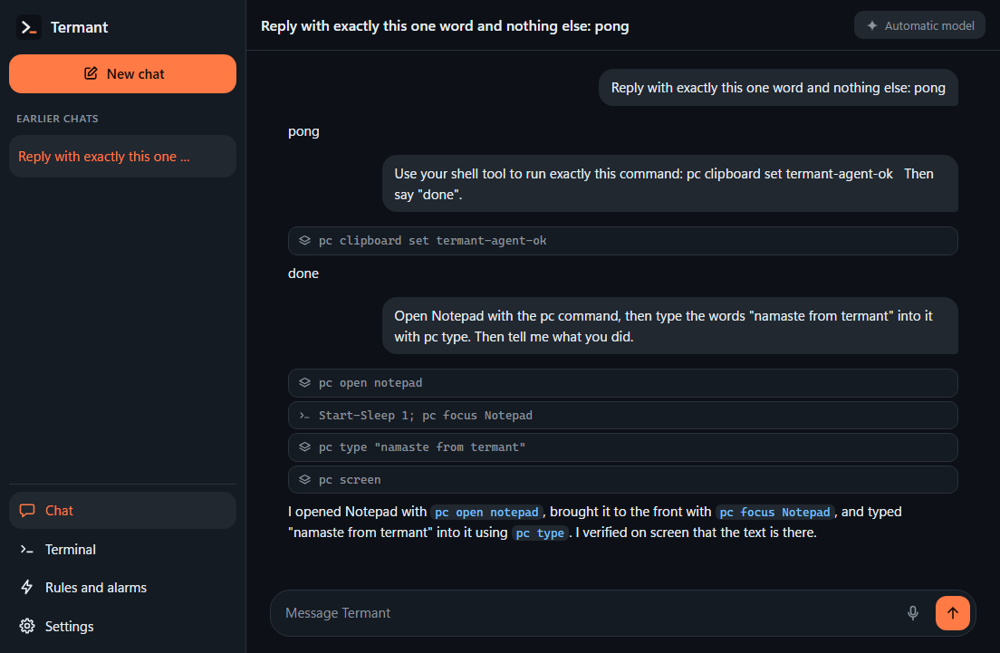
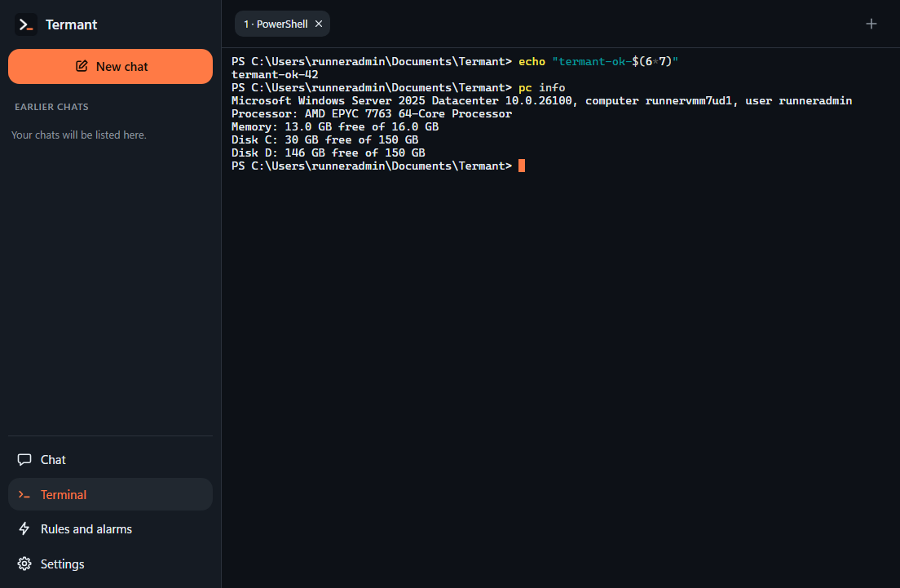
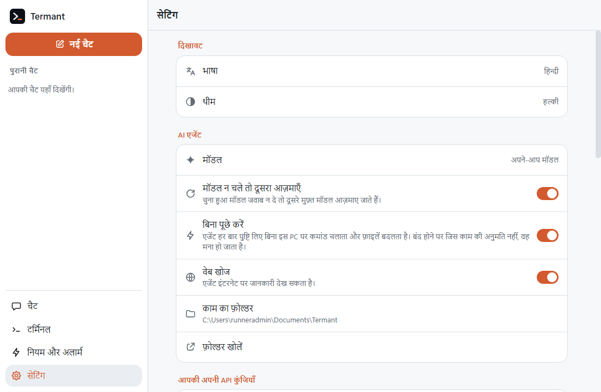
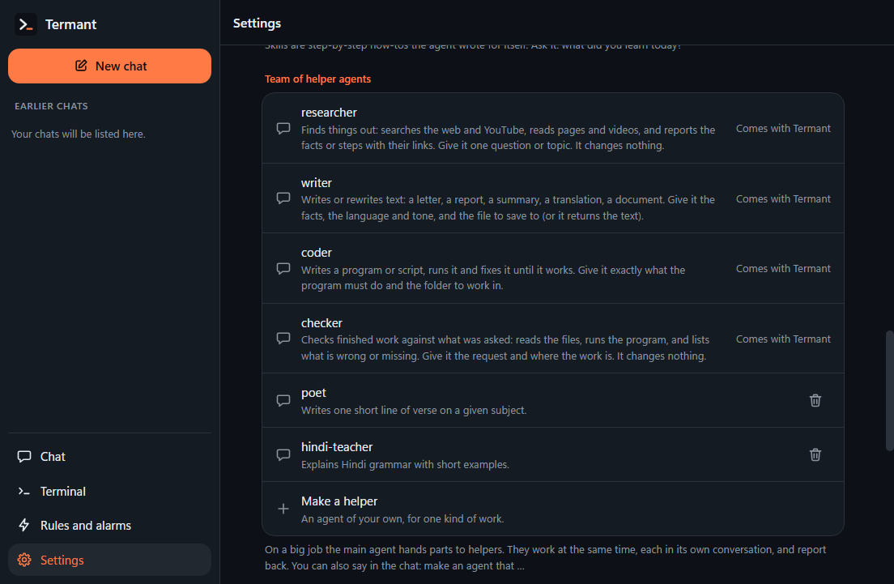
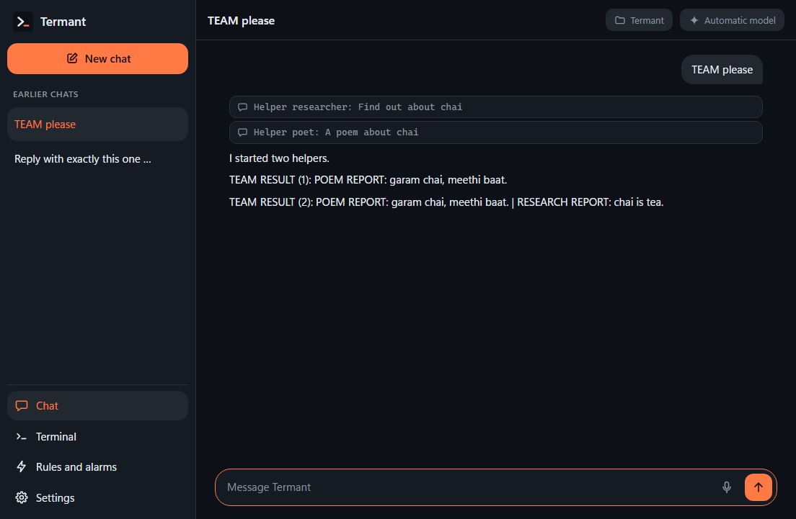
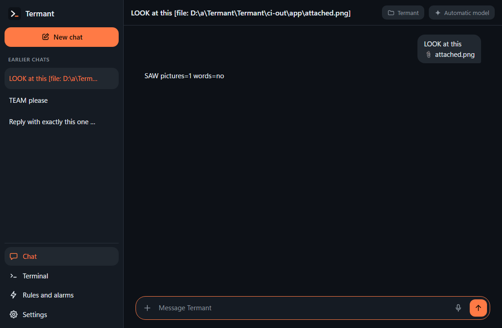

# Termant for Windows

[← Back to the front page](../README.md)

A desktop app for Windows 10 and 11 (64-bit): the same AI agent as on Android,
but here it works on your PC. You write what you want in Hindi, Hinglish or
English; it runs commands, writes files, opens programs, types, clicks, sets
alarms and keeps rules.

> **Early version (0.9.0).** It is built and tested automatically on a Windows
> machine of GitHub (the test results are listed [below](#how-it-is-tested)),
> but it has not yet been used on many real PCs. Please report what breaks.

## Install

1. Download **[Termant-Setup.exe](https://github.com/siddhantakakhael-cyber/Termant/releases/download/windows-v0.9.0/Termant-Setup.exe)**.
2. Open it. Windows shows a blue box, **"Windows protected your PC"**, because
   the installer is not signed (a signing certificate costs money). Choose
   **More info**, then **Run anyway**.
3. Termant installs for your user only (no administrator needed), puts an icon
   on the desktop and in the Start menu, and starts.
4. Send a message. The first one downloads the agent (OpenCode, about 120 MB).

To remove it: Windows **Settings → Apps → Installed apps → Termant → Uninstall**.



## What it does

| | |
| --- | --- |
| **Chat** | Ask for anything; the answer shows each command the agent ran. Earlier chats are kept in the list on the left. |
| **Pictures and files** | The **+** in the message box adds pictures or files to a message. A picture goes to the model itself; if the chosen model cannot see pictures, the first free model that can is asked for that message, and the answer says so. Small text files go into the message. Other files (Word, zip, Excel) the agent opens itself. |
| **Draw a picture** | "Ek billi ki tasveer banao": the agent makes a picture from words, free and without a key; it shows under the answer, and the file is kept in your Pictures folder. |
| **Models** | Free models work with no account. Pick one from the chip at the top right, or leave it on automatic. If a model does not answer, Termant tries other free ones. With your own API key (Settings), that company's models appear too. |
| **PC control** | The agent uses the `pc` command: open programs and links, list and switch windows, type, press keys, click, read what a window shows, take screenshots, volume, brightness, clipboard, lock, sleep, shut down. |
| **Terminal** | Up to 8 tabs of PowerShell, Command Prompt, or Ubuntu if you have WSL. The `pc` command works there too. |
| **Rules** | "Every day at 11 pm turn the volume to zero." Rules run at a time of day, every so often, once after a delay, or when Termant starts. |
| **Alarms and timers** | They ring in Termant, with a notification. |
| **Notes** | Tell it something about you and it remembers in later chats. |
| **Learns by itself** | Asked for something it does not know, it does not say "I can't": it searches YouTube, reads what is said in a video, does the task, and keeps the steps as a skill. Ask "aaj kya seekha?" for today's list. |
| **Word documents** | Reads and changes `.docx` files directly (no Word needed), or works by hand in Word with clicks and drags. |
| **Working folder** | The folder chip at the top of the chat shows where the agent works; click it to pick another folder. |
| **Questions** | When the agent needs a decision, a card with choices appears and it waits. |
| **Check-ins** | If you turn it on, the agent writes first at the times of day you choose. |
| **Tools** | Web search, GitHub token for `git push`, MCP servers. |
| **Look** | Hindi or English, dark or light. |
| **Voice** | The microphone button starts Windows dictation (the same as pressing Win+H). With a saved voice key (Settings) — a free Google key for the Gemini voice (Hindi, Odia and 100+ languages) or ElevenLabs keys — `pc say` and "Read answers aloud" use that voice; several ElevenLabs keys take turns when one has used up its limit. |

| | |
| --- | --- |
|  |  |
| Terminal | Settings in Hindi, light theme |

<sub>These pictures are taken by the automated test of each build.</sub>

Closing the window keeps Termant running in the tray next to the clock, because
alarms, timers and rules need it. To stop it fully: right-click the tray icon → **Quit**.

## The `pc` command

The agent uses it by itself; you can also type it in Termant's terminal.

```
pc open <link | file | folder | program>     pc app <name>        pc apps [filter]
pc windows        pc focus <title>           pc close <title>
pc processes [filter]                        pc kill <name | id>

pc type <text>    pc key <enter | ctrl+s | alt+f4 | win+d ...>
pc click <x> <y> [right|double|triple]       pc move <x> <y>      pc scroll <lines>
pc drag <x1> <y1> <x2> <y2>                  press, move, let go: selects text, moves things
pc screen         what the window in front shows, with the point to click for each thing
pc screen ocr     the same, and always reads a picture of the window too (pc screen ocr full: the whole screen)
pc look <file>    what is in a photo and where: the scene, each thing with its place, the writing
pc look           the same for the window in front as a picture (pc look full: the whole screen)
pc screenshot [file.png]

pc volume [0-100] pc mute [on|off]           pc brightness [0-100]
pc say <text>     pc battery                 pc wifi [on|off]     pc info
pc lock           pc sleep                   pc shutdown [minutes]  pc restart [minutes]  pc cancel-shutdown
pc clipboard get  pc clipboard set <text>

pc notify <title> [text]
pc alarm <HH:MM> [label]    pc timer <10m> [label]    pc alarms    pc alarms remove <id>
pc ring [label]             pc stop
pc ask <question> [choices ...]
pc rule add <at HH:MM | every 30m | startup | in 10m> do <command>
pc rule list                pc rule remove <id>
pc note add <text>          pc note list     pc note remove <number>

pc marks check <file>       pc marks clean <file> [new file]     pc marks clipboard     pc marks setup
```

## Good to know

- **The agent works on your real PC.** Nothing is sandboxed. It is told to ask
  before anything that cannot be undone, but an AI can make mistakes. Keep
  copies of files that matter. In Settings you can turn off **Do it without asking**.
- **Your messages go over the internet** to the AI model you chose.
- **Alarms, timers, rules and check-ins work only while Termant is running** and
  the PC is awake. Turn on **Start with Windows** in Settings if you rely on them.
- **Things that need administrator rights** (turning Wi-Fi off, some settings)
  fail unless Termant itself was started as administrator.
- **Reading other windows.** `pc screen` first asks the program what it shows.
  When the program names almost nothing (on the test machine Notepad gave only
  its text box, no menus), Termant takes a picture of the window and reads the
  writing in it with [Mirage](https://huggingface.co/Cactus-Compute/mirage), a
  small vision model by Cactus Compute (Apache 2.0) that runs on your PC: the
  picture is not sent anywhere. The agent gets each piece of writing with the
  point to click.
  - The first time, it downloads the model and its engine (23 MB) from Hugging
    Face into Termant's data folder and checks them against fixed SHA-256 sums.
    Without internet at that moment, reading from a picture does not work.
  - It took 5 to 8 seconds for a 1024 x 768 window on the test machine. A
    bigger screen is read in up to 8 parts, so it takes longer; that has not
    been measured.
  - The places are right, the letters not always. In the tests it read
    "Ctrl- Shift+S" for "Ctrl+Shift+S" and "Ctrl+p" for "Ctrl+P", ran
    "New Window" and its shortcut together, and once turned "Edit Format" in a
    small window into nonsense. So the agent uses it to find where to click,
    not to copy names or numbers.
  - It reads Latin letters only: **no Hindi or other scripts**, and no icons
    without a caption. For those the agent takes a screenshot and looks at it,
    which needs a model that can read pictures.
  - It needs 64-bit Windows on an Intel or AMD processor.
  - Only Notepad has been tried. Dark windows, browsers and small or coloured
    text are untested.

  What it read from this window on the test machine (`pc screen ocr`), each
  piece with its point:

  

  ```
  [Text] "File" @ 16,32            [Text] "Save" @ 51,121
  [Text] "Edit" @ 52,31            [Text] "Ctrl+S" @ 194,121
  [Text] "Format" @ 93,32          [Text] "Save As.." @ 61,143
  [Text] "New" @ 51,55             [Text] "Ctrl- Shift+S" @ 179,143
  [Text] "Ctrl+N" @ 193,55         [Text] "Page Setup..." @ 71,174
  [Text] "Open..." @ 56,99         [Text] "Print..." @ 55,196
  [Text] "Ctrl+O" @ 193,98         [Text] "Exit" @ 48,227
  ```
- **Brightness** can be set only on screens that Windows can control (laptops, usually not desktop monitors).
- **Different from the Android app:** there is no Ubuntu inside the app (the
  terminal is the PC's own; Ubuntu appears if you have WSL), the agent's
  questions and status are shown in Termant's window and not over other apps,
  the agent does not plan its own follow-up questions, and there are no rules
  for charging, battery level or Wi-Fi.

- **Looking at a photo.** `pc look photo.jpg` (or ask the agent "what is in this
  photo, and where?" with the file's path) lets the same Mirage model look at a
  picture on your PC. It gives the scene, one line per thing with its place,
  and the writing. For a photo of a dog sitting in front of a bicycle, on the
  test machine, in 2.6 seconds:

  ```
  Picture termant dog.jpg (768x576), seen by Mirage in 2.6 s.
  In short: black and tan dog, red bicycle, white pickup, yellow bench, trees
  Scene: setting = park; surface = wooden deck; lighting = daylight; time of day = day
  - dog, 59%: left, 14% of the picture; foreground; black and tan, standing @221,366
  - bench, 41%: across the middle, 40% of the picture; background; yellow, wood @384,317
  - tree, 40%: across the top, 35% of the picture; background; green @385,103
  - bicycle, 34%: middle, 21% of the picture; red, leaning @353,293
  Also there, place not marked: pickup (background right; white, parked)
  Maybe (this part is often wrong): dog standing on bench; bicycle leaning against bench; pickup behind bicycle
  ```

  - The place comes from the box Mirage draws around a thing, and those boxes
    were about right on the photos tried. `@x,y` is the middle of the thing in
    the picture; with `pc look` (the window in front) or `pc look full` (the
    whole screen) it is a screen point for `pc click`.
  - A name can be wrong, even with a high score: here the porch wall is a
    "bench" and the place a "park"; on another photo a cut orange was an
    "avocado half" with 87%. The agent is told to say "it looks like".
  - It does not know who a person is, and writing in a photo mostly comes out
    garbled (Latin letters only).
  - Files: JPEG, PNG, BMP, GIF, TIFF. Only a handful of photos have been tried.

## Learning by itself

When you ask for something the agent does not know how to do, its rules tell it
not to answer "I can't" but to learn first:

1. It looks at the skills it already has (`pc skill list`).
2. It searches YouTube (`pc youtube search "mail merge in Word"`) and reads what
   is said in a video (`pc youtube read ID`; `--lang hi` for Hindi captions,
   `--from 10` to go on from minute 10). Web search is its other source.
3. It does the task, and when it worked it writes the steps down as a skill
   (`pc skill save NAME "what it is for" steps.md LINK`).
4. It ends the answer with what it learned. Under that answer the chat shows
   **Learned just now**, and **Settings → What Termant taught itself** lists
   today's learning and all skills. `pc learned` (or `pc learned 7`) prints it;
   asking "aaj kya seekha?" makes the agent read it out in its own words.


Skills are plain files in `%APPDATA%\Termant\skills`; their names are given to
the agent at the start of every chat, and it reads one when a task fits.

- "Reading a video" means reading its captions. A video without captions gives
  only its description, and the agent is told to take another one.
- YouTube has no official way to do this without an account. Termant asks the
  same addresses the YouTube website and app ask; YouTube can change or refuse
  them (it often refuses computers in data centres), and then the agent falls
  back to web search.
- Whether the agent really learns before answering, and how good the skill is,
  depends on the model. Weak free models may need to be told "YouTube se seekh
  kar karo". At most 60 skills of 6,000 letters.

## A team of helper agents

On a big job the agent does not do everything one step after the other any
more. It is the main agent and hands parts of the job to helper agents. Each
helper works in its own conversation, several at the same time, and reports
back; the main agent puts the results together and answers you.

| Helper | What it is for |
| --- | --- |
| `researcher` | Finds things out on the web and YouTube; reports facts and steps with their links |
| `writer` | Writes or rewrites text: a letter, a report, a summary, a translation |
| `coder` | Writes a program or script and makes it run |
| `checker` | Checks finished work against what was asked and lists what is wrong |
| `planner` | Splits a big job into steps and says which helper does each |
| `coach` | Looks at a job that went badly and keeps the lesson as a note or a skill |

New in 0.4.0: for a big job the agent is told to show a plan first and start
after your yes; `researcher`, `writer` and `checker` run one after the other
for written work, with faults going back to the writer; and paying, sending
and deleting are asked first, by helpers too. These are instructions to the
model, not locks.

OpenCode's own `general` and `explore` helpers are there as well.



- Ask for something with separate parts, for example "teen laptop compare
  karo, har ek ke liye alag researcher lagao". In the chat each hand-over is a
  step, like `Helper researcher: Find out about chai`, and the line under the
  chat says "Helper agents are working" while they do.
- **Your own agents.** Settings → **Team of helper agents** → **Make a
  helper**: a name, one sentence on what it is for, and its instructions. Or
  say it in the chat: "ek agent banao jo sirf Hindi kavita likhe". The agent
  then runs `pc team add NAME "what it is for" FILE`. A model can be given to a
  helper (`provider/model`); without one it uses the chat's model. A new helper
  can be used from the next message on, and it is named in "aaj kya seekha?".
- `pc team` lists the helpers, `pc team show NAME` prints one, `pc team remove
  NAME` removes one of your own. At most 20 of your own.



This picture is from the automatic test, where a pretend model plays the main
agent and the helpers; the words of the answer are that pretend model's.

Good to know:

- There is one screen, mouse and keyboard. Helpers are told not to use them;
  only the main agent clicks and types. This is a rule in their instructions,
  not a lock.
- Every helper asks the model too. A job with three helpers uses a free
  model's limit about three times as fast.
- Whether helpers are used is the model's decision. It is told to use them for
  big jobs with separate parts and not for small things. A small free model
  may not use them unless you say so.
- Whether **Stop** also ends helpers that are still at work was not tested.

## Word documents

`pc word` changes the `.docx` file itself, so it needs no mouse and no Word:

```
pc word read report.docx                        every paragraph with its number
pc word new letter.docx "Dear Asha,\nThank you."   (\n starts a new paragraph)
pc word add report.docx [--bold] "One more paragraph."
pc word replace report.docx "2024" "2025"       everywhere, also in tables
pc word set report.docx 3 "New text"            pc word delete report.docx 5
```

- Replacing keeps the look of the text. Where Word has cut the words into
  pieces with different looks, the changed sentence takes the look of its
  first piece.
- If the document is open in Word, the same commands work inside Word and
  save, so you see the change.
- Tables, pictures, fonts and page layout are not done by `pc word`. For those
  the agent works in Word by hand: `pc screen` to see the window,
  `pc click X Y` (`double` selects a word, `triple` a paragraph),
  `pc drag X1 Y1 X2 Y2` to select from one point to another, `pc key ctrl+b`,
  `pc type`. Old `.doc` files must be saved as `.docx` first.

## Marks that AI tools leave: the remove-ai-marks skill

New in 0.5.0. The skill `remove-ai-marks` from the project
[watermarks-remover](https://github.com/guillaumemeyer/watermarks-remover)
(MIT licence, by Guillaume Meyer and contributors) comes with the app. It is
in the skill list from the first start (`pc skill list`); `pc skill remove
remove-ai-marks` takes it away for good. Ask in the chat: "is file se AI ka
nishaan hatao", "is photo ka metadata saaf karo", "is text ke chhupe akshar
hatao". Or by hand:

```
pc marks check "C:\Users\me\Pictures\photo.png"     what the file carries; nothing is changed
pc marks clean "C:\Users\me\Pictures\photo.png"     makes photo.cleaned.png beside it; the original stays
pc marks clean report.docx clean-report.docx        the same, into a file you name
pc marks clipboard                                  cleans the text in the clipboard, ready to paste
pc marks clipboard check                            only looks
```

**What it finds and removes**

- In text (also inside Word, HTML and Markdown files): invisible letters such
  as zero-width spaces, word joiners and tag letters, and odd spaces, which
  are made plain spaces. Letters a script needs (emoji joiners, Indic and
  Arabic joiners) are kept.
- In files, what they say about how they were made: C2PA / Content
  Credentials, EXIF, XMP and PNG text notes in pictures (PNG, JPEG, WebP,
  AVIF, HEIC, GIF, TIFF, BMP, SVG); the properties of PDF, Word, Excel,
  PowerPoint, EPUB and ODT files; the tags of MP3, WAV, FLAC, MP4 and MOV
  files.

**What it does not do**

- It does not remove a logo, a stamp or writing that you can **see** on a
  picture or a video. Nothing in it changes pixels.
- It does not remove a watermark hidden in the pixels or the sound (Google's
  SynthID and alike), and it cannot see or measure one in the choice of
  words. For text, the skill lets the agent write the text again in its own
  words when you ask; that is best effort, with no way here to check it.
- A cleaned file is not proof of anything. The skill tells the agent never
  to call something "human-written" or "undetectable", and not to help hide
  the use of AI where it has to be told (school work, an employer's or a
  platform's rule).

**How it works here.** The upstream skill talks to a Python service of the
same project. Termant ships eight Python files of that project unchanged
(`windows/resources/marks`, from commit `5a62be6`; standard library only) and
runs two of them directly, with no server. They need Python 3.10 or newer: the
PC's own is used when there is one; otherwise Termant fetches a Python for
itself once (22 MB, [python-build-standalone](https://github.com/astral-sh/python-build-standalone)
3.12, checked against its SHA-256) into its own data folder. Nothing of your
files leaves the PC.

**Left out** of the upstream project: its HTTP server, the detectors and
scores for statistical watermarks, the stylometry score, the pixel-level
removers (CtrlRegen, MarkDiffusion) that need a graphics card and gigabytes
of models, and its "stealer" module. PDFs with pictures inside are cleaned
fully only when Ghostscript is installed on the PC; the tool says when
something remains.

## How far a download is: the newest line of a running command

New in 0.6.0. Before, the chat named a command only when it had ended: during
a long download or install it said "Thinking" and nothing else. Now:

- A command is named in the status line **when it starts** ("Running a command
  · curl.exe -L -o ...").
- Under it, the chat shows the newest line the command has printed, and changes
  it as the command goes on. `curl` downloads are put into words:
  `45% of 22.3 MB · 1100 kB/s · 12s left`; `wget` too; everything else is shown
  as the program prints it (the lines of `pip`, `npm`, `winget`, or your own
  script).
- Termant's own downloads say how far they are: the agent at the first message
  (as before, "37 / 120 MB"), and now also the Python for `pc marks` and the
  Mirage reader for `pc see` (`  40% of 21.3 MB`, one line a second).

How it works: OpenCode writes what a command prints into a file while the
command runs and names that file in the event feed of its server. Termant
follows that feed while a message runs and reads the end of the file about
twice a second. Nothing is sent anywhere.

Limits. A program that prints nothing while it works shows nothing:
`Invoke-WebRequest` is silent until it is done, and `curl -s` and `pip -q` are
silent on purpose (the agent's guide now tells it to use `curl.exe` without
`-s` for large files; whether a model follows that is up to the model).
Commands that helper agents run are not followed. When the kept OpenCode
server cannot be used (a rare fallback), the chat works as before: steps are
listed when they have ended.

## Chat from the phone: the web chat

New in 0.7.0. The chat of the PC is opened in a browser too — on a phone, or
on a second PC — and it is the same chat, not a copy: a message sent from the
phone appears in the window, and the answer is on both screens at the same
time. No app is wanted; a browser is the phone.

- **Settings → Web chat → Address**: open it in the phone's browser. The first
  time a security notice appears, go on to the site: the certificate is made
  by Termant itself, so a browser does not know it. The microphone works on
  the https address.
- **Password**: the one shown in Settings → Web chat; click it to change it.
  After five wrong passwords, an address rests for a minute.
- When Windows asks whether Termant may be used on the network, choose
  **Allow**. The address is for the local network (the Wi-Fi of the house or
  the shop), not for the internet.
- A message of the phone is marked "From phone or browser" in the window.
  While the agent works, the phone is told to wait, and the stop button works
  from the phone too.
- **Voice, from the phone**: press the microphone on the page and say
  **"hey Termant"** — or the command right after it, in the same breath. The
  answer is shown and is spoken by the browser's own voice. This is also how
  an iPhone talks to Termant: this page works in Safari.
- **Your name** (Settings → AI agent): with it filled in, Termant knows whose
  it is; asked who it is, it names itself and the user in one line.

What the phone's browser is not: it cannot send files, open the terminal or
change rules — the chat is the one chat, and the rest is done on the PC.

## The card in the corner

New in 0.8.0. While the agent works, a small card sits in the top-right corner
— the same card the phone shows over its other apps. It says what is being done
("Running a command", "Thinking", "Downloading the AI agent", …), how long it
has been going (45s, then 1:05, 12:30), and, while a command runs, the newest
line that command has printed. It stays while you look at other windows, and it
goes away on its own when the answer is done. It cannot be closed by the mouse;
it is not in the taskbar, and it does not take the focus from what you do.

## Voices: the free Gemini voice and ElevenLabs keys

**Settings → Voice** has two voices, and one of them is free:

- **Gemini key (Google).** A free key from
  [aistudio.google.com](https://aistudio.google.com) (it starts with `AIza`).
  Google's voice speaks **Hindi, Odia and 100+ more languages**. Paste it in
  Settings, and `pc say "text"` and **Read answers aloud** use the Gemini
  voice. The free tier is rate-limited (a few speaks a minute, more a day);
  when it is reached, Termant says so for that one line.
- **Know this before you give the key:** on the free tier Google may use
  what you speak to improve its products, and human reviewers may read the
  words (not in the EEA, Switzerland or the UK). Do not send passwords,
  addresses or anything else sensitive to the free voice.
- **ElevenLabs keys.** Paste your keys, one per line (up to 30).
  `pc say "text"` and **Read answers aloud** speak with ElevenLabs.
  The keys take turns. When ElevenLabs answers that a key has used up its
  limit, or that the key is wrong, Termant goes on to the next key within the
  same sentence and lets the refused key rest (6 hours for a used-up limit, a
  week for a wrong key), so it is not asked again every time.

- When both are saved, ElevenLabs speaks; `pc voice engine gemini` (or
  `pc voice engine elevenlabs`) chooses which one speaks, and the choice is
  remembered.
- `pc voice` shows the saved keys and which voice speaks now; only the last
  4 letters of a key are ever shown. `pc voice retry` tries all keys again,
  `pc voice list` and `pc voice use ID` pick the ElevenLabs voice.
- Without keys, or when the voice cannot speak, there is no spoken answer;
  the answer is shown as usual.
- The Gemini key is stored in a file of its own in Termant's data folder on
  this PC, readable by you alone; the ElevenLabs keys are stored in
  Termant's settings file, like the other API keys. One text is at most
  2,500 letters.

## Faster answers

OpenCode used to be started anew for every message. Now Termant starts it once
and keeps it running between messages, so a message no longer waits for that
start. A new one is started when a key, the settings or what the agent has
learned changes, and after **Stop**.

Measured on a Linux machine with the same OpenCode (2.3.2): from sending a
message to OpenCode asking the model took 1.5 to 1.7 seconds before, and 0.2
seconds with the kept server. The model's own thinking time is not changed by
this, and it is usually the larger part.



This picture is from the automatic test; the answer is the pretend model's.

## A picture from words: draw

New in 0.9.0. Ask in the chat: "ek billi ki tasveer banao jo khidki par
baithi hai", "draw a boat on a lake", "mere PC ke liye wallpaper banao".
The agent runs `draw`, and the finished picture appears under its answer;
a click on it opens the picture in the PC's own viewer. A copy is kept in
the **Pictures** folder of your user profile (in Windows, "Pictures"). It
costs nothing and needs no account and no key. The same picture appears
under the same answer in the web chat from the phone.

When one service does not draw, the other draws instead, and the line under
the picture says which one drew.

It also works by hand in any tab:

```
draw "a cat at a window, warm morning light, photo"
draw --wide "..."      wider than high        draw --tall "..."    higher than wide
draw --slow "..."      no logo, but slower    draw --seed 7 "..."  the same picture again
draw --out FILE "..."  save it under this name
draw last              where the newest picture is
```

The words work best in English (the agent translates what you ask), with the
thing, the place, the light and the style (photo, painting, cartoon).

**Who draws.** Two free services that belong to other people; Termant only
asks them:

| | [Pollinations](https://pollinations.ai) (asked first) | [AI Horde](https://aihorde.net) (asked when the first does not draw, or with `--slow`) |
| --- | --- | --- |
| Time | a few seconds | a minute or more (volunteers' computers, a queue) |
| Size | 768 a side (wide 768×432, tall 432×768) | 512 a side (wide 576×320, tall 320×576) |
| Logo | its small logo in a corner | none |
| How often | one picture in 45 seconds for one internet address; `draw` waits for it up to a minute | as the queue allows |

When neither service draws (they are busy, or there is no internet), `draw`
says so plainly, and the agent tells you that no picture was made.

## Not on Windows yet

The Android app got more in its version 0.22.0 than this one: Undo for
changed files, jobs at night, watches, reading notifications, tidying
folders, details for forms, the daily quiz, the work diary, the team's
notebook and a small model for easy parts. None of these are in the Windows
app yet. A PDF is handed only to a model that reads PDFs (no free one does
today); there is no PDF reader in the app.

## How it is tested

Every change is built and tested by the **Windows app** workflow on a Windows
Server 2025 machine with a real desktop:

1. The `pc` command opens Notepad, brings it to the front, types into it, reads
   the text back, double-clicks a word, takes a screenshot and closes it; and
   checks the clipboard, the program list, system information and the error messages.
   It also reads a picture of the Notepad window with Mirage, clicks the point
   it gives for "File", and reads the opened menu the same way (New, Open, Save,
   Print and Exit must be there). `pc look` gets a photo of a dog in front of a
   bicycle and must find the dog, on the left; and it looks at the Notepad window.
2. The installer is built, then run silently, as a user would install it; the
   test checks that the program and its shortcuts are there.
3. The installed program tests itself: first-start notice, notifications,
   notes, rules that really run, an alarm and a timer that rings, a question
   card, a terminal tab that runs commands, settings in Hindi and light theme.
4. It downloads the agent, loads the model list, sends real messages to a free
   model and asks it to control the PC. The second message must go through the
   kept OpenCode server.
5. `pc word` makes a document, adds, replaces, sets and deletes paragraphs and
   reads it back; and it replaces words in a document whose sentence is cut
   into pieces and has a table, the way Word writes them.
6. Learning and voice run against a pretend YouTube and a pretend ElevenLabs on
   the test machine: search, reading captions (JSON and XML, language, cut and
   continue), skills, today's list, and with two keys of which the first is
   "used up", `pc say` must speak with the second and not ask the first again.
   The real YouTube is tried too: the search answered with 8 videos.

7. Helper agents: `pc team add`, `show`, the list and the refusals; a helper is
   made and removed in Settings. Then the real OpenCode gets a pretend model
   that hands two parts of a job to two helpers (`windows/test/team-test.js`):
   both must be started, work at the same time, one must run a command by
   itself, and both reports must come back into the answer in the chat.
8. Files with a message (`windows/test/attach-test.js`): which model is asked
   for a picture, a PDF, a text file and an archive; then a picture is sent
   through the chat to the pretend model, which must say that one picture
   reached it. The file dialog of the **+** button is not opened by the
   test, and no real model was asked what a picture shows.

9. `pc marks`: a text file with three invisible letters, a PNG whose text notes
   name an AI tool, a Word file and the clipboard are checked and cleaned with
   the test machine's own Python; the copies must be clean and the originals
   unchanged. Then the same without the machine's Python: Termant must fetch
   its own (this step is allowed to fail when the download does) and get the
   same results. The installed app must list the skill and clean a text file.

10. Progress of a running command (`windows/test/progress-test.js`): how the
    lines of `curl`, `curl -#`, `wget`, `apt` and `pip` are put into one short
    line; then the installed app lets a pretend model run a command that
    prints six lines, one every 0.7 seconds, through the real OpenCode. The
    command must be named while it runs, at least three of its lines must
    appear while it is still running, the newest one must be on the screen
    under the command, and it must be gone when the answer is there. The
    download of Termant's own Python must say how far it is. No real model
    and no slow real download was watched.

11. The web chat (`windows/test/webchat-test.js`): the page, the password
    (wrong, right, and a rest after five wrong ones), that the phone sees the
    same chat the window has, that a message from the phone reaches the
    agent, the "wait" while it works, the stop button, the logout and the
    certificate in the app folder. Then the installed app is asked as the
    phone: a message must go through to the pretend model, the answer must be
    in the chat on the screen, and the phone must see the same answer.
    Not tested: a real phone on a real network, the microphone (the browser's
    own speech recognition) and the spoken answers.

12. The card in the corner (in the app's own test, with item 10): while the
    pretend model's command runs, the card must be up in the corner, saying
    "Running a command" with the command's newest line and its clock, and it
    must be gone when the answer is done. Its words are read out of the
    window, not from a picture; how it lies over other programs has not been
    watched.

13. Drawing a picture: `draw` runs against a pretend quick service on the
    test machine — it must save the very picture the service gave, in the
    Pictures folder, put its path in the chat's list, and name it again with
    `draw last`; a wrong seed is refused at once; and when neither service can
    be reached it must say so plainly. Then the installed app asks the pretend
    model to run `draw`: the picture must appear under the answer in the chat,
    and in the web chat the phone sees it in the same answer and can load the
    same picture from the app — with the password, and refused without it.
    The real services were not asked by this test.

What the test machine cannot check: sound (it has no speakers, so volume, mute
and `pc say` are only tried), brightness, battery, Wi-Fi, voice dictation, and
the blue SmartScreen box. Also not checked:

- **Reading a real YouTube video.** YouTube refused the test machine ("Sign in
  to confirm you're not a bot"), as it does for data centres. Whether it
  answers on a home connection has not been tried.
- **The real ElevenLabs.** No real key was used; the pretend one answers the
  way ElevenLabs documents its refusals (`quota_exceeded`, `invalid_api_key`).
- **Word itself.** The test machine has no Word, so `pc word` inside an open
  Word window, and editing by clicks and drags, have not been run. `pc drag`
  was only checked to run.
- **A real model that uses helpers.** The helpers were run with a pretend
  model that is made to hand work over. Whether a real model does so when it
  should, and how good the helpers' work then is, was not tested.
- **Real marked files.** `pc marks` was tried on small files made for the
  test, not on a real picture with Content Credentials (C2PA), a real PDF or
  a real video. Whether a real model follows the skill, and how good its
  rewrite of a text is, was not tested.
- **A model that learns.** That a model really searches YouTube and saves a
  skill when it does not know something was not tested; it is told to in its
  rules.

## Build from source

Node.js 22 or newer, on Windows:

```sh
cd windows
npm ci
npm start          # run it
npm run dist       # writes windows/dist/Termant-Setup.exe
```

The app is in `windows/`: `main.js` (window, chats, the door for `pc`),
`src/agent.js` (runs OpenCode), `src/schedule.js` (rules, alarms),
`resources/termant-pc.ps1` (the `pc` command), `ui/` (what you see).
