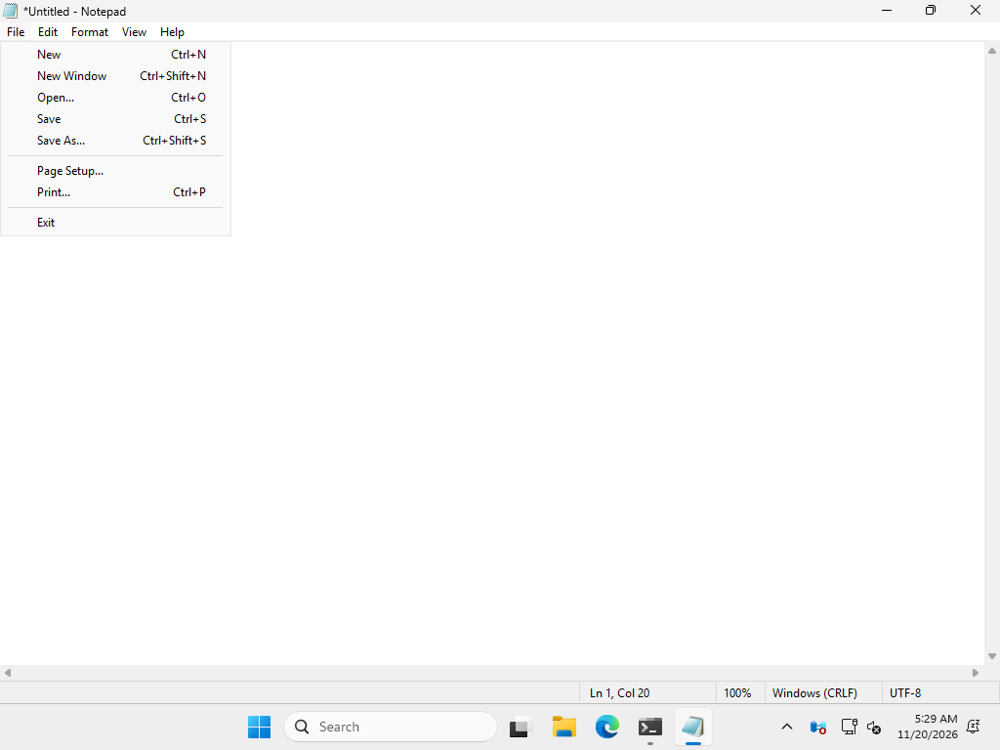
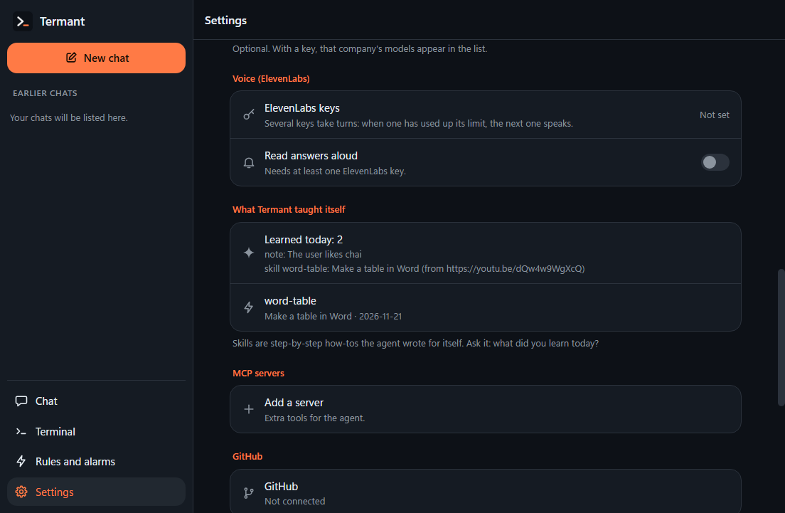

# Termant for Windows

[← Back to the front page](../README.md)

A desktop app for Windows 10 and 11 (64-bit): the same AI agent as on Android,
but here it works on your PC. You write what you want in Hindi, Hinglish or
English; it runs commands, writes files, opens programs, types, clicks, sets
alarms and keeps rules.

> **Early version (0.2.0).** It is built and tested automatically on a Windows
> machine of GitHub (the test results are listed [below](#how-it-is-tested)),
> but it has not yet been used on many real PCs. Please report what breaks.

## Install

1. Download **[Termant-Setup.exe](https://github.com/siddhantakakhael-cyber/Termant/releases/download/windows-v0.2.0/Termant-Setup.exe)**.
2. Open it. Windows shows a blue box, **"Windows protected your PC"**, because
   the installer is not signed (a signing certificate costs money). Choose
   **More info**, then **Run anyway**.
3. Termant installs for your user only (no administrator needed), puts an icon
   on the desktop and in the Start menu, and starts.
4. Send a message. The first one downloads the agent (OpenCode, about 120 MB).

To remove it: Windows **Settings → Apps → Installed apps → Termant → Uninstall**.


## What it does

| | |
| --- | --- |
| **Chat** | Ask for anything; the answer shows each command the agent ran. Earlier chats are kept in the list on the left. |
| **Models** | Free models work with no account. Pick one from the chip at the top right, or leave it on automatic. If a model does not answer, Termant tries other free ones. With your own API key (Settings), that company's models appear too. |
| **PC control** | The agent uses the `pc` command: open programs and links, list and switch windows, type, press keys, click, read what a window shows, take screenshots, volume, brightness, clipboard, lock, sleep, shut down. |
| **Terminal** | Up to 8 tabs of PowerShell, Command Prompt, or Ubuntu if you have WSL. The `pc` command works there too. |
| **Rules** | "Every day at 11 pm turn the volume to zero." Rules run at a time of day, every so often, once after a delay, or when Termant starts. |
| **Alarms and timers** | They ring in Termant, with a notification. |
| **Notes** | Tell it something about you and it remembers in later chats. |
| **Learns by itself** | Asked for something it does not know, it does not say "I can't": it searches YouTube, reads what is said in a video, does the task, and keeps the steps as a skill. Ask "aaj kya seekha?" for today's list. |
| **Word documents** | Reads and changes `.docx` files directly (no Word needed), or works by hand in Word with clicks and drags. |
| **Working folder** | The folder chip at the top of the chat shows where the agent works; click it to pick another folder. |
| **Questions** | When the agent needs a decision, a card with choices appears and it waits. |
| **Check-ins** | If you turn it on, the agent writes first at the times of day you choose. |
| **Tools** | Web search, GitHub token for `git push`, MCP servers. |
| **Look** | Hindi or English, dark or light. |
| **Voice** | The microphone button starts Windows dictation (the same as pressing Win+H). With ElevenLabs keys (Settings), `pc say` and "Read answers aloud" use that voice; several keys take turns when one has used up its limit. |

| | |
| --- | --- |
|  |  |
| Terminal | Settings in Hindi, light theme |

<sub>These pictures are taken by the automated test of each build.</sub>

Closing the window keeps Termant running in the tray next to the clock, because
alarms, timers and rules need it. To stop it fully: right-click the tray icon → **Quit**.

## The `pc` command

The agent uses it by itself; you can also type it in Termant's terminal.

```
pc open <link | file | folder | program>     pc app <name>        pc apps [filter]
pc windows        pc focus <title>           pc close <title>
pc processes [filter]                        pc kill <name | id>

pc type <text>    pc key <enter | ctrl+s | alt+f4 | win+d ...>
pc click <x> <y> [right|double|triple]       pc move <x> <y>      pc scroll <lines>
pc drag <x1> <y1> <x2> <y2>                  press, move, let go: selects text, moves things
pc screen         what the window in front shows, with the point to click for each thing
pc screen ocr     the same, and always reads a picture of the window too (pc screen ocr full: the whole screen)
pc look <file>    what is in a photo and where: the scene, each thing with its place, the writing
pc look           the same for the window in front as a picture (pc look full: the whole screen)
pc screenshot [file.png]

pc volume [0-100] pc mute [on|off]           pc brightness [0-100]
pc say <text>     pc battery                 pc wifi [on|off]     pc info
pc lock           pc sleep                   pc shutdown [minutes]  pc restart [minutes]  pc cancel-shutdown
pc clipboard get  pc clipboard set <text>

pc notify <title> [text]
pc alarm <HH:MM> [label]    pc timer <10m> [label]    pc alarms    pc alarms remove <id>
pc ring [label]             pc stop
pc ask <question> [choices ...]
pc rule add <at HH:MM | every 30m | startup | in 10m> do <command>
pc rule list                pc rule remove <id>
pc note add <text>          pc note list     pc note remove <number>
```

## Good to know

- **The agent works on your real PC.** Nothing is sandboxed. It is told to ask
  before anything that cannot be undone, but an AI can make mistakes. Keep
  copies of files that matter. In Settings you can turn off **Do it without asking**.
- **Your messages go over the internet** to the AI model you chose.
- **Alarms, timers, rules and check-ins work only while Termant is running** and
  the PC is awake. Turn on **Start with Windows** in Settings if you rely on them.
- **Things that need administrator rights** (turning Wi-Fi off, some settings)
  fail unless Termant itself was started as administrator.
- **Reading other windows.** `pc screen` first asks the program what it shows.
  When the program names almost nothing (on the test machine Notepad gave only
  its text box, no menus), Termant takes a picture of the window and reads the
  writing in it with [Mirage](https://huggingface.co/Cactus-Compute/mirage), a
  small vision model by Cactus Compute (Apache 2.0) that runs on your PC: the
  picture is not sent anywhere. The agent gets each piece of writing with the
  point to click.
  - The first time, it downloads the model and its engine (23 MB) from Hugging
    Face into Termant's data folder and checks them against fixed SHA-256 sums.
    Without internet at that moment, reading from a picture does not work.
  - It took 5 to 8 seconds for a 1024 x 768 window on the test machine. A
    bigger screen is read in up to 8 parts, so it takes longer; that has not
    been measured.
  - The places are right, the letters not always. In the tests it read
    "Ctrl- Shift+S" for "Ctrl+Shift+S" and "Ctrl+p" for "Ctrl+P", ran
    "New Window" and its shortcut together, and once turned "Edit Format" in a
    small window into nonsense. So the agent uses it to find where to click,
    not to copy names or numbers.
  - It reads Latin letters only: **no Hindi or other scripts**, and no icons
    without a caption. For those the agent takes a screenshot and looks at it,
    which needs a model that can read pictures.
  - It needs 64-bit Windows on an Intel or AMD processor.
  - Only Notepad has been tried. Dark windows, browsers and small or coloured
    text are untested.

  What it read from this window on the test machine (`pc screen ocr`), each
  piece with its point:

  

  ```
  [Text] "File" @ 16,32            [Text] "Save" @ 51,121
  [Text] "Edit" @ 52,31            [Text] "Ctrl+S" @ 194,121
  [Text] "Format" @ 93,32          [Text] "Save As.." @ 61,143
  [Text] "New" @ 51,55             [Text] "Ctrl- Shift+S" @ 179,143
  [Text] "Ctrl+N" @ 193,55         [Text] "Page Setup..." @ 71,174
  [Text] "Open..." @ 56,99         [Text] "Print..." @ 55,196
  [Text] "Ctrl+O" @ 193,98         [Text] "Exit" @ 48,227
  ```
- **Brightness** can be set only on screens that Windows can control (laptops, usually not desktop monitors).
- **Different from the Android app:** there is no Ubuntu inside the app (the
  terminal is the PC's own; Ubuntu appears if you have WSL), the agent's
  questions and status are shown in Termant's window and not over other apps,
  the agent does not plan its own follow-up questions, and there are no rules
  for charging, battery level or Wi-Fi.

- **Looking at a photo.** `pc look photo.jpg` (or ask the agent "what is in this
  photo, and where?" with the file's path) lets the same Mirage model look at a
  picture on your PC. It gives the scene, one line per thing with its place,
  and the writing. For a photo of a dog sitting in front of a bicycle, on the
  test machine, in 2.6 seconds:

  ```
  Picture termant dog.jpg (768x576), seen by Mirage in 2.6 s.
  In short: black and tan dog, red bicycle, white pickup, yellow bench, trees
  Scene: setting = park; surface = wooden deck; lighting = daylight; time of day = day
  - dog, 59%: left, 14% of the picture; foreground; black and tan, standing @221,366
  - bench, 41%: across the middle, 40% of the picture; background; yellow, wood @384,317
  - tree, 40%: across the top, 35% of the picture; background; green @385,103
  - bicycle, 34%: middle, 21% of the picture; red, leaning @353,293
  Also there, place not marked: pickup (background right; white, parked)
  Maybe (this part is often wrong): dog standing on bench; bicycle leaning against bench; pickup behind bicycle
  ```

  - The place comes from the box Mirage draws around a thing, and those boxes
    were about right on the photos tried. `@x,y` is the middle of the thing in
    the picture; with `pc look` (the window in front) or `pc look full` (the
    whole screen) it is a screen point for `pc click`.
  - A name can be wrong, even with a high score: here the porch wall is a
    "bench" and the place a "park"; on another photo a cut orange was an
    "avocado half" with 87%. The agent is told to say "it looks like".
  - It does not know who a person is, and writing in a photo mostly comes out
    garbled (Latin letters only).
  - Files: JPEG, PNG, BMP, GIF, TIFF. Only a handful of photos have been tried.

## Learning by itself

When you ask for something the agent does not know how to do, its rules tell it
not to answer "I can't" but to learn first:

1. It looks at the skills it already has (`pc skill list`).
2. It searches YouTube (`pc youtube search "mail merge in Word"`) and reads what
   is said in a video (`pc youtube read ID`; `--lang hi` for Hindi captions,
   `--from 10` to go on from minute 10). Web search is its other source.
3. It does the task, and when it worked it writes the steps down as a skill
   (`pc skill save NAME "what it is for" steps.md LINK`).
4. It ends the answer with what it learned. Under that answer the chat shows
   **Learned just now**, and **Settings → What Termant taught itself** lists
   today's learning and all skills. `pc learned` (or `pc learned 7`) prints it;
   asking "aaj kya seekha?" makes the agent read it out in its own words.



Skills are plain files in `%APPDATA%\Termant\skills`; their names are given to
the agent at the start of every chat, and it reads one when a task fits.

- "Reading a video" means reading its captions. A video without captions gives
  only its description, and the agent is told to take another one.
- YouTube has no official way to do this without an account. Termant asks the
  same addresses the YouTube website and app ask; YouTube can change or refuse
  them (it often refuses computers in data centres), and then the agent falls
  back to web search.
- Whether the agent really learns before answering, and how good the skill is,
  depends on the model. Weak free models may need to be told "YouTube se seekh
  kar karo". At most 60 skills of 6,000 letters.

## Word documents

`pc word` changes the `.docx` file itself, so it needs no mouse and no Word:

```
pc word read report.docx                        every paragraph with its number
pc word new letter.docx "Dear Asha,\nThank you."   (\n starts a new paragraph)
pc word add report.docx [--bold] "One more paragraph."
pc word replace report.docx "2024" "2025"       everywhere, also in tables
pc word set report.docx 3 "New text"            pc word delete report.docx 5
```

- Replacing keeps the look of the text. Where Word has cut the words into
  pieces with different looks, the changed sentence takes the look of its
  first piece.
- If the document is open in Word, the same commands work inside Word and
  save, so you see the change.
- Tables, pictures, fonts and page layout are not done by `pc word`. For those
  the agent works in Word by hand: `pc screen` to see the window,
  `pc click X Y` (`double` selects a word, `triple` a paragraph),
  `pc drag X1 Y1 X2 Y2` to select from one point to another, `pc key ctrl+b`,
  `pc type`. Old `.doc` files must be saved as `.docx` first.

## ElevenLabs voice with several keys

**Settings → Voice (ElevenLabs) → ElevenLabs keys**: paste your keys, one per
line (up to 30). Then `pc say "text"` speaks with ElevenLabs, and **Read
answers aloud** speaks every answer.

- The keys take turns. When ElevenLabs answers that a key has used up its
  limit, or that the key is wrong, Termant goes on to the next key within the
  same sentence and lets the refused key rest (6 hours for a used-up limit, a
  week for a wrong key), so it is not asked again every time.
- `pc voice` shows for each key how many letters are used and whether it
  rests; only the last 4 letters of a key are ever shown. `pc voice retry`
  tries all keys again, `pc voice list` and `pc voice use ID` pick the voice.
- Without keys, or when no key can speak, the PC's own voice is used.
- The keys are stored in Termant's settings file on this PC, like the other
  API keys. One text is at most 2,500 letters.

## Faster answers

OpenCode used to be started anew for every message. Now Termant starts it once
and keeps it running between messages, so a message no longer waits for that
start. A new one is started when a key, the settings or what the agent has
learned changes, and after **Stop**.

Measured on a Linux machine with the same OpenCode (2.3.2): from sending a
message to OpenCode asking the model took 1.5 to 1.7 seconds before, and 0.2
seconds with the kept server. The model's own thinking time is not changed by
this, and it is usually the larger part.

## How it is tested

Every change is built and tested by the **Windows app** workflow on a Windows
Server 2025 machine with a real desktop:

1. The `pc` command opens Notepad, brings it to the front, types into it, reads
   the text back, double-clicks a word, takes a screenshot and closes it; and
   checks the clipboard, the program list, system information and the error messages.
   It also reads a picture of the Notepad window with Mirage, clicks the point
   it gives for "File", and reads the opened menu the same way (New, Open, Save,
   Print and Exit must be there). `pc look` gets a photo of a dog in front of a
   bicycle and must find the dog, on the left; and it looks at the Notepad window.
2. The installer is built, then run silently, as a user would install it; the
   test checks that the program and its shortcuts are there.
3. The installed program tests itself: first-start notice, notifications,
   notes, rules that really run, an alarm and a timer that rings, a question
   card, a terminal tab that runs commands, settings in Hindi and light theme.
4. It downloads the agent, loads the model list, sends real messages to a free
   model and asks it to control the PC. The second message must go through the
   kept OpenCode server.
5. `pc word` makes a document, adds, replaces, sets and deletes paragraphs and
   reads it back; and it replaces words in a document whose sentence is cut
   into pieces and has a table, the way Word writes them.
6. Learning and voice run against a pretend YouTube and a pretend ElevenLabs on
   the test machine: search, reading captions (JSON and XML, language, cut and
   continue), skills, today's list, and with two keys of which the first is
   "used up", `pc say` must speak with the second and not ask the first again.
   The real YouTube is tried too: the search answered with 8 videos.

What the test machine cannot check: sound (it has no speakers, so volume, mute
and `pc say` are only tried), brightness, battery, Wi-Fi, voice dictation, and
the blue SmartScreen box. Also not checked:

- **Reading a real YouTube video.** YouTube refused the test machine ("Sign in
  to confirm you're not a bot"), as it does for data centres. Whether it
  answers on a home connection has not been tried.
- **The real ElevenLabs.** No real key was used; the pretend one answers the
  way ElevenLabs documents its refusals (`quota_exceeded`, `invalid_api_key`).
- **Word itself.** The test machine has no Word, so `pc word` inside an open
  Word window, and editing by clicks and drags, have not been run. `pc drag`
  was only checked to run.
- **A model that learns.** That a model really searches YouTube and saves a
  skill when it does not know something was not tested; it is told to in its
  rules.

## Build from source

Node.js 22 or newer, on Windows:

```sh
cd windows
npm ci
npm start          # run it
npm run dist       # writes windows/dist/Termant-Setup.exe
```

The app is in `windows/`: `main.js` (window, chats, the door for `pc`),
`src/agent.js` (runs OpenCode), `src/schedule.js` (rules, alarms),
`resources/termant-pc.ps1` (the `pc` command), `ui/` (what you see).
